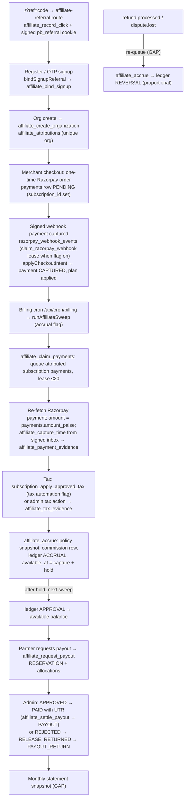

# PostBus affiliate dashboard and program plan

Status: plan only, written 2026-10-27. No code, no migration, and no database write came with this file. Production (`hgacoeoovjxkzfbesmvl`, the target of `.env.local` and the `:3000` dev server) must not be migrated or mutated as part of any step below without a separate, explicit approval.

Offer: **20% recurring commission on referred merchants' PostBus subscription payments.**

This plan builds on the existing draft. It does not start a second affiliate stack. Where a section says EXISTS, the code is already in the working tree (uncommitted). Where it says GAP, it has to be built.

---

## 0. Business decisions

**Accepted 2026-10-27: all proposed defaults.** These rules are now final:

| # | Decision |
| --- | --- |
| D1 | Commission is 20% of the GST-exclusive taxable value |
| D2 | Commission lasts 24 months from the merchant's first paid payment |
| D3 | Hold of 30 days for monthly payments and 45 days for yearly payments |
| D4 | 30-day attribution window |
| D5 | ₹1,000 minimum payout, settled once a month in a fixed window |
| D6 | Collect PAN and deduct TDS under section 194H (rate and threshold to be confirmed with the CA before P5); GSTIN optional |
| D7 | Subscription payments only; no add-ons or AI credits |
| D8 | Suspension stops new accruals; termination for fraud forfeits the unpaid balance |
| D9 | Attribution is permanent, bounded by D2 |
| D10 | Existing merchants may be partners and may refer other organizations, not their own |
| D11 | Only payments captured on or after 2026-11-01 earn commission |

The remaining sections were written with these defaults. Where they still offer an alternative (for example "if D1 = inclusive"), that alternative is out of scope. The partner terms must move to `2026-11-v2`, replacing "lifetime" with the 24-month term and the suspension wording with D8.

The table below is the original options analysis, kept for the record.

| # | Decision | Options | Proposed default | Why it matters |
| --- | --- | --- | --- | --- |
| D1 | **Commission base: GST-exclusive or GST-inclusive** | (a) 20% of the taxable value, excluding GST. (b) 20% of the amount the merchant actually paid, including GST. | (a) exclusive | PostBus remits the GST, so it is not revenue. The current code and the terms page (`/partner/terms`) already say "after taxes". Option (b) pays partners about 18% more than PostBus keeps. Option (b) also removes the tax-evidence blocker entirely (see §3.2). |
| D2 | **Lifetime or capped** | (a) Lifetime of the merchant. (b) First N months after the merchant's first paid payment, for example 12 or 24. (c) First N payments. | (b) 24 months | Today the code has no cap and the terms page says "lifetime". A cap needs a schema change (§6, phase P2). |
| D3 | **Hold or lock period before payable** | 7, 15, 30 or 45 days after capture | 30 days (current `hold_days`) | Razorpay chargebacks can arrive well after 30 days. A longer hold means fewer post-payout recoveries. Monthly payments need at least one full cycle to cover "pay, use, refund". |
| D4 | **Attribution window (click → signup)** | 30, 60 or 90 days | 30 days (current `attribution_days`) | The cookie window only. Once the organization is created, attribution is permanent, subject to D2. |
| D5 | **Minimum payout and cadence** | ₹500, ₹1,000 or ₹2,500; monthly or on request | ₹1,000, settled once a month in a fixed window (for example the 5th to the 10th) | Today a partner can request at any time. A fixed monthly window makes batching and TDS simpler. |
| D6 | **TDS and KYC** | (a) Collect PAN and deduct TDS under section 194H (commission, 2% from Oct 2024 for resident individuals), with a GSTIN for registered partners. (b) Defer and cap payouts below the threshold. | (a) | Commission payments to Indian residents above the 194H yearly threshold (raised to ₹20,000 from 2025-04-01) require TDS. **Confirm the rates and threshold with your CA.** This plan does not give tax advice. Without PAN, TDS is 20% under section 206AA. |
| D7 | **Add-ons and AI credits** | (a) Subscription plans only. (b) Also paid add-ons such as AI Accountant (`payment_purpose = addon`). (c) Also AI credit wallet top-ups. | (a) | Add-on payments have no `subscription_id`, so they are `INELIGIBLE` today. Including them needs a change to the eligibility rule in `affiliate_accrue`. |
| D8 | **Suspended or terminated partner** | (a) Keep accruing, hold payouts (current terms text). (b) Stop new accruals on suspend. (c) On termination for fraud, forfeit unpaid balance. | (b) plus (c) for fraud terminations only | Today `affiliate_accrue` does not look at partner status. Suspended partners keep earning. |
| D9 | **Merchant who cancels and returns later** | (a) Original partner keeps the attribution forever. (b) Attribution lapses after N days with no paid subscription, and a new partner can claim it. | (a), bounded by D2 | Today `affiliate_attributions.organization_id` is unique and permanent. Option (b) needs a lapse rule and a new attribution version. |
| D10 | **Who can be a partner** | (a) Anyone approved. (b) Not existing PostBus merchants. (c) Existing merchants may refer only other organizations. | (c) | Existing merchants are likely to be your best referrers. Self-referral is already blocked by user id (§3.6). |
| D11 | **Free period until 2026-10-31** | Payments before 2026-11-01 earn commission, or only those from that date | From 2026-11-01. In practice there are almost no paid payments before then. | Sets the launch date for accrual. |

---

## 1. Partner-facing dashboard

All screens live under `app/(site)/partner/*`, rendered by `components/affiliates/partner-portal.tsx` inside `partner-shell.tsx`. The data comes from `/api/partner/[...slugs]` → `handlePartnerApi` in `modules/affiliates/api.ts`. Every read takes `affiliate_id` from the session's `affiliate_profiles` row, never from the request.

Privacy rule for all partner screens (EXISTS, keep it): never show a merchant's organization name, email, phone, GSTIN, plan price or Razorpay ids. Referral rows use the label `Merchant xxxxxxxx` from `affiliate_partner_records`.

### 1.1 Onboarding: `/partner`, `/partner/register`, `/partner/login`

- EXISTS: sign up or sign in with the same Supabase identity, the application form (`applicationSchema`), terms `2026-10-v1`, and statuses PENDING, APPROVED, REJECTED and SUSPENDED with a rejection reason.
- GAP: a public marketing page (`/partners` or `/affiliate`) that explains the 20% offer, the cap (D2), the hold (D3) and the payout cadence (D5). Today `/partner` is a bare card.
- GAP: the terms page must be rewritten once D1 to D10 are decided. It currently promises "lifetime" and "suspension continues to accrue", which may conflict with D2 and D8. Changing the terms bumps the version (`2026-11-v2`), and existing partners must re-accept before their next payout.

### 1.2 Overview: `/partner/dashboard`

Shows, for a date range (EXISTS through `affiliate_summary`):

| Card | Source | Status |
| --- | --- | --- |
| Referral clicks, unique visitors | `affiliate_click_events` | EXISTS |
| Merchant signups | `affiliate_attributions` count | EXISTS |
| Trials started | attributions whose subscription is `TRIAL` | GAP: add `trials` to `affiliate_summary` |
| Trial → paid conversions | distinct attributions with capture evidence | EXISTS as `conversions` |
| Conversion rate (signup → paid) | conversions ÷ signups | GAP: today it divides by visitors, which mixes two funnels. Show both rates. |
| **Active referred merchants** | attributions whose latest subscription is `ACTIVE` and within the commission term (D2) | GAP |
| Pending, payable (available), reserved, paid, reversed, recoverable | `affiliate_balance` plus summary | EXISTS, except **recoverable** is not shown. Add it with an explanation: "refunds after payout, offset against future earnings". |
| Next payout date and estimate | settings (D5) plus available balance | GAP |
| Charts: clicks, signups, conversions, earnings per day | `daily` and `activity` | EXISTS |

GAP: a status banner for PENDING, REJECTED (with reason), SUSPENDED and "terms re-acceptance required".

### 1.3 Referral link and code: `/partner/links`

- EXISTS: primary link `https://www.postbus.in/?ref=<24-char code>` created on approval, copy button, QR from `/api/partner/qr`, per-link stats from `affiliate_partner_link_stats`.
- GAP: share buttons for WhatsApp, Facebook, LinkedIn and email. These are plain share URLs, not separate tracking, as `POSTBUS_AFFILIATE_IMPLEMENTATION_PLAN.md` phase H says.
- GAP (optional, needs a decision): a human-readable code such as `PB12345` that the merchant types at signup or checkout. It is out of scope for this release per the PRD. Only add it if you want phone or offline referrals. If you do, it must resolve to the same `affiliate_links` row and pass the same self-referral checks.

### 1.4 Campaigns: `/partner/campaigns`

- EXISTS: create campaign links with UTM fields and a landing path (`/`, `/pricing`, `/partner`), and see per-link clicks, signups and conversions.
- GAP: disable or archive own campaign link (today only an admin can disable a link). Disabling a link stops new clicks and claims. It never removes earned commission.

### 1.5 My referrals: `/partner/referrals`

One row per attributed merchant (EXISTS through `affiliate_partner_records`, `p_type = 'referrals'`): label, signup date, subscription status, commission status.

GAP columns:

- `first_paid_at`
- `commission_ends_at` (from D2)
- `billing_cycle` (monthly or yearly). This is safe to show and helps partners forecast.
- `payments_count`
- `lifetime_commission`
- A lifecycle badge: Trial, Paid, Active, Past due, Cancelled, Expired, Term ended.

Do not show the plan price.

### 1.6 Commission ledger: `/partner/commissions`

One row per commissioned payment (EXISTS through `affiliate_partner_records`, `p_type = 'commissions'`). Status mapping, which must be spelled out on the page:

| Partner status | Ledger meaning |
| --- | --- |
| PENDING | `ACCRUAL` exists, `available_at` is in the future (hold), or tax or capture review is pending |
| APPROVED / PAYABLE | `APPROVAL` exists and is not yet allocated to a payout |
| PAID | allocated to a payout request in status `PAID` |
| REVERSED | a `REVERSAL` exists (partial or full refund or chargeback). Show the reversed amount, not just the flag. |

GAP:

- Rename `PAYABLE` to `APPROVED` (or keep `PAYABLE` and say "approved, payable" in the label) so the partner and admin screens use the same words.
- Per row: payment month, cycle (monthly or yearly), net base (if D1 is exclusive, show "net of GST"), rate, commission, hold release date, reversal amount.
- A second tab, **Ledger**, that lists raw `affiliate_ledger_entries` (`ACCRUAL`, `APPROVAL`, `REVERSAL`, `ADJUSTMENT`, `RESERVATION`, `RELEASE`, `PAYOUT`, `PAYOUT_RETURN`) with a running balance. The API list `ledger` EXISTS but no screen uses it.
- CSV export of the partner's own rows.

### 1.7 Payouts: `/partner/payouts`

- EXISTS: available balance, minimum payout and total paid cards, the payout history list, and the request RPC (`affiliate_request_payout`), all behind `POSTBUS_AFFILIATE_PAYOUTS_ENABLED`. Today the screen says "not available yet".
- GAP once payouts are enabled:
  - A request form: choose a saved account, amount defaulting to the full available balance, idempotency key.
  - Status timeline: REQUESTED → APPROVED → PAID (with settlement reference and date), or REJECTED, REVIEW or RETURNED, with the reason.
  - TDS line per payout if D6(a): gross, TDS, net transferred.
  - A request is blocked if KYC is incomplete (§1.8) or terms re-acceptance is pending.

### 1.8 Payout details and KYC: `/partner/profile` (new section) or `/partner/payout-details`

- EXISTS: `POST /api/partner/accounts` stores UPI (name and VPA) encrypted with `INTEGRATION_ENCRYPTION_KEY`. The API returns only the mask. Accounts are immutable, so a change is a new row.
- GAP: no screen saves or lists accounts. Build one:
  - UPI, and optionally bank account plus IFSC, encrypted the same way. Show only the mask.
  - **PAN** (required if D6(a)), legal name matching PAN, optional GSTIN with place of supply, and address.
  - KYC status: NOT_STARTED, SUBMITTED, VERIFIED or REJECTED (with reason). An admin verifies it (§2.6).
  - A changed payout destination starts a cooling-off period (for example 72 hours) before the next payout, and creates a notification. This is the standard defence against account takeover.
- Storage: new table `affiliate_kyc` (encrypted PAN, a masked PAN, name, GSTIN, status, `verified_by`, `verified_at`), insert-only like the payout accounts.

### 1.9 Statements: `/partner/statements` (new)

GAP, nothing exists. One statement per calendar month per partner:

- Opening balance, accruals, approvals, reversals, adjustments, payouts, TDS, closing balance (payable, pending and recoverable).
- Line items: commissioned payments in the month, using the same masking rules.
- Download as PDF and CSV. If D6(a), add a TDS certificate reference (Form 16A is issued quarterly by PostBus's accountant, outside this app, and only referenced here).
- Generated from the ledger by a SQL function `affiliate_statement(p_affiliate, p_month)`. Store a frozen snapshot row `affiliate_statements` when the month closes, so later corrections show as adjustments in the next month and never rewrite a closed statement.

### 1.10 Notifications and support

- EXISTS: `affiliate_notifications` rows (approval, rejection, payout status) and the `/partner/support` page.
- GAP: show notifications in the shell (a bell icon or list). Optionally send email through the existing provider for approval, first commission, payable, and paid events.

---

## 2. Admin screens: `/admin/affiliates`

EXISTS: one page (`components/affiliates/admin-dashboard.tsx`) with an overview from `affiliate_admin_overview`, raw tables per section, CSV export of a page, and a single "record an action" form. Every mutation needs the admin PIN and a reason, and writes `affiliate_audit_logs`. This works but is a raw console. The plan splits it into task-shaped screens that use the same API (`handleAffiliateAdmin`) and RPC (`affiliate_admin_action`).

### 2.1 Overview

EXISTS: partners, pending applications, signups, paid merchants, earned, paid, liability and review queue.

GAP:

- Payable this cycle.
- Commission as a percentage of subscription revenue.
- Top partners.
- Items blocked in `TAX_REVIEW` and `CAPTURE_REVIEW`, with links into the queues.

### 2.2 Applications and partners

- Application queue: application fields, risk flags (`risk.identity_overlap`, and the new ones in §3.6). Approve or reject with a reason. Approval creates the primary link (EXISTS in SQL).
- Partner detail page (GAP): profile, links, referrals, commissions, ledger, payouts, KYC, audit trail and notes, all scoped to one `affiliate_id`. Today the admin filters by pasting a partner UUID.
- Status actions: approve, reject, suspend, reinstate (EXISTS), and **terminate for fraud** (GAP, D8: forfeits the unpaid balance through an `ADJUSTMENT` with a reason, and blocks future accruals).

### 2.3 Overrides

- Commission rate override per partner or per link (EXISTS: the `policy` action inserts a new versioned `affiliate_policies` row). A new rate only affects payments captured after `effective_at`. GAP: show the effective policy for each partner on their detail page.
- Commission term override per partner (GAP, follows D2): for example 36 months for a strategic reseller.
- Attribution correction (EXISTS: `correction` action → `affiliate_attribution_corrections`; applies to future captures only). GAP: a merchant search to pick the attribution, instead of raw ids.
- Manual adjustment, positive or negative (EXISTS: `adjustment` action with a client UUID key).

### 2.4 Holds and review queues

- Processing queue (EXISTS as section `reconciliation`, `affiliate_processing`) and the reconciliation report (EXISTS as `report`, with categories `PAYMENT_UNVERIFIED`, `MISSING_TAX_EVIDENCE`, `MISSING_COMMISSION`, `OWNERSHIP_MISMATCH`, `REFUND_REVIEW`, `LEDGER_MISMATCH`, `MATCHED`).
- GAP: a **commission hold** action, separate from the time-based hold. It freezes one commission or a whole partner (no `APPROVAL` inserted, and no payout request) until released, with a reason. Use it for fraud review. It needs a new table `affiliate_holds` (scope = partner or commission, `placed_by`, `released_by`, reason), and `affiliate_accrue` and `affiliate_request_payout` must both check it.
- GAP: a one-click "record tax" from a `MISSING_TAX_EVIDENCE` row. This is only needed if D1 = exclusive and tax automation is not on (§3.2).

### 2.5 Payouts

- EXISTS: `affiliate_settle_payout` with APPROVED, REJECTED, REVIEW, PAID (reference ≥ 3 characters, idempotent) and RETURNED. Reading the decrypted destination is audited (`payout.destination_viewed`).
- GAP:
  - A payout run screen for the monthly window (D5): all REQUESTED payouts, KYC state, risk flags, gross, TDS and net. Bulk approve. Export a bank or UPI batch file (CSV), and mark each PAID with its UTR.
  - TDS fields on `affiliate_payout_requests` (`tds_paise`, `tds_section`, `net_paise`), written at approval time. The ledger keeps the gross `PAYOUT`, and TDS is a reporting split, not a second ledger kind. Confirm this treatment with the CA.
  - A quarterly TDS report (PAN, gross, TDS) for filing.

### 2.6 KYC review (new)

A queue of `affiliate_kyc` rows in SUBMITTED status. View the decrypted PAN and name (audited, the same as a destination view), then verify or reject with a reason.

### 2.7 Reversals

- EXISTS: refunds append `REVERSAL` automatically when the sweep sees `amount_refunded` grow. After a payout, this shows up as `recoverable`.
- GAP: a reversal list (refunds and chargebacks in the last N days, partner, amount, whether already paid). A manual reversal action for chargebacks that Razorpay reports as disputes instead of refunds (§3.4).
- GAP: a recoverable balances list, so admin can see who owes money and either offset it (automatic against future approvals) or write it off (an `ADJUSTMENT` with a reason).

### 2.8 Audit trail

- EXISTS: `affiliate_audit_logs` (append-only; written by every admin action, profile change and destination view).
- GAP: a filterable view (partner, actor, action, date) with JSON detail and CSV export, plus a link to it from every partner detail page.

### 2.9 Settings

EXISTS: registration open, attribution days, hold days and minimum payout. GAP: commission term (D2), payout window day (D5), the TDS toggle (D6), and the current terms version.

---

## 3. Commission rules for 20% recurring

### 3.1 What earns

- One commission per verified captured subscription payment (`payments` row with `subscription_id`, INR, not `ai_credits`), for an organization attributed to the partner before that capture. EXISTS.
- Checkout today is a one-time Razorpay order per period, not a Razorpay recurring subscription. **"Recurring" means each renewal payment the merchant makes earns again.** Each renewal is a new `payments` row, so `affiliate_commissions.payment_id` stays unique and a new commission accrues. EXISTS and tested.
- Since commit `8a52c36`, the plan is applied only after payment is verified (`applyCheckoutIntent`, also called from the `payment.captured` webhook). That matches the affiliate rule that only verified captures earn. A merchant who never pays a renewal simply stops generating commission. There is no "failed renewal" event to handle.
- Trials earn nothing (EXISTS). Payments before 2026-11-01 are out of scope (D11).

### 3.2 Base: GST-exclusive vs inclusive (D1)

- **If exclusive (proposed):** base = captured − GST. Today the GST figure has two sources:
  1. `subscription_apply_approved_tax`, from `20261017130000_subscription_tax_policy.sql`, behind `POSTBUS_BILLING_TAX_AUTOMATION_ENABLED`. With an approved inclusive tax policy (for example 18%), it writes `subscription_tax_breakdowns`, and from those the affiliate tax evidence. This is the path to use. Without it, every commission waits on a manual admin tax entry.
  2. A manual `tax` admin action (EXISTS). This is the fallback only.

  Prerequisite: the tax policy and tax invoice migrations (`20261017130000`, `20261017140000`, and `20261027150000_organization_billing_profiles.sql`) must be live. On production, `organization_billing_profiles` and `subscription_tax_invoices` are known to be missing (PGRST205).
- **If inclusive:** base = captured amount. This needs a code change: `affiliate_accrue` would accept a policy flag `base = 'GROSS'` and skip tax evidence. That is simpler, but it pays commission on GST.

Example at ₹1,499 per month GST-inclusive with 18% GST: taxable = 149900 × 10000 / 11800 = ₹1,270.34. The commission at 20% is ₹254.07 (exclusive) or ₹299.80 (inclusive).

### 3.3 Monthly vs yearly

- Monthly: one commission per monthly payment, each with its own hold.
- Yearly: one commission on the full yearly payment, at capture time (EXISTS: 2,000,000 paise → 400,000 paise). It is not spread over 12 months.
  - Risk: a yearly refund after payout creates a large recoverable balance. Mitigation options: a longer hold for yearly (D3 can be per-cycle: `hold_days_yearly`), or approve 1/12 per month. **Proposed:** the same rule, but `hold_days_yearly = max(hold_days, refund window)`. Confirm under D3.
- Monthly → yearly upgrade: the upgrade is a new checkout payment, so it earns on its own captured amount. A downgrade is scheduled (`pending_plan_id`) and takes effect at the next payment, which earns on its lower amount. There is no proration path today (`changePlan` refuses upgrades without checkout), so there is no special case.

### 3.4 Refunds and chargebacks

- Refund (partial or full): `refund.processed` marks the payment `REFUNDED`. The sweep re-fetches the Razorpay payment, sees a larger `amount_refunded`, writes new evidence, and `affiliate_accrue` appends a proportional `REVERSAL` (key `refund:<payment>:<refunded paise>`). This EXISTS and is tested. Before approval, the reversal reduces pending. After payout, it becomes `recoverable` and is offset against future approvals.
- GAP, refund detection timing: the sweep re-polls every attributed payment roughly every 24 hours, forever (`next_attempt_at = now + 24h` after any terminal status). That is both slow to react and an unbounded Razorpay API load. Fix it in two parts:
  1. In the webhook handler, on `refund.processed` for an attributed payment, set `affiliate_processing.next_attempt_at = now()`. This is a small, flag-gated change.
  2. Stop re-polling a payment once it is RECONCILED and older than the refund and chargeback horizon (for example 180 days). Mark it `FINAL`.
- GAP, chargebacks: Razorpay disputes (`payment.dispute.created`, `.won`, `.lost`) are not handled anywhere. Proposal:
  - On `dispute.created` for an attributed payment, place a commission hold (§2.4).
  - On `dispute.lost`, append a full `REVERSAL` with key `dispute:<payment>`.
  - On `dispute.won`, release the hold.
  - This needs the dispute webhooks enabled in the Razorpay dashboard. That is a manual step for you.

### 3.5 Hold or lock period (D3)

`available_at = captured_at + hold_days` (EXISTS). Until then the commission is PENDING (only `ACCRUAL`). After that, a sweep inserts `APPROVAL` and it becomes payable. Manual holds (§2.4) and disputes extend this. Proposed: 30 days for monthly payments and 45 days for yearly ones, pending D3.

### 3.6 Attribution window, self-referral and fraud

- Window (D4): the signed `pb_referral` cookie, first touch, 30 days by default (EXISTS). Binding happens only for a brand-new auth user (created less than 10 minutes ago) with no organization (EXISTS). Organization creation locks the attribution permanently (EXISTS, unique per organization).
- Self-referral: the link owner's `user_id` must differ from the signing-up user (EXISTS), and a correction to a member of the organization is refused (EXISTS).
- GAP fraud checks, all as **flags for review, not automatic bans**. These write `affiliate_audit_logs` with `risk.*` actions and place an automatic commission hold on the first commission:
  - The partner's mobile or email matches the merchant's billing profile, owner phone or Razorpay payment `email`/`contact`.
  - The partner's PAN or GSTIN matches the merchant's GSTIN (`organization_billing_profiles`).
  - The same Razorpay payment method fingerprint (card or VPA) appears across a partner and their referrals. Use only what the existing payment fetch returns. Do not store raw card data.
  - Click velocity: many clicks with no signups from one visitor, or signups within seconds of a click. Use the existing click rows. No IP is stored, and the plan keeps it that way.
  - Many referred merchants that pay once and refund. Track the partner refund ratio and flag it above a threshold.
- PostBus staff accounts (`platform_admins`) cannot be partners. GAP: a check at application time.

### 3.7 Plan changes, cancellation, reactivation

- A plan change earns on whatever amount is next captured (EXISTS, no special path).
- Cancellation means no further payments, so no further commission. Commission already earned stays, unless that payment is refunded.
- An expired merchant who reactivates and pays earns again for the original partner while within the commission term (D2 and D9).
- A merchant who deletes the organization and signs up again as a new organization would be a new signup. The attribution would only go to a partner if the new auth user arrives through a link, and existing users are blocked from binding. This is acceptable.

### 3.8 Lifetime vs capped (D2)

GAP. Implementation if capped:

- New column `affiliate_settings.commission_months` (null means lifetime), plus an optional per-partner override on `affiliate_policies.duration_months`.
- `affiliate_accrue` returns `TERM_ENDED` when `e.captured_at > first_paid_at + duration`. `first_paid_at` is the earliest capture evidence for the attribution. Cache it on `affiliate_attributions.first_paid_at`, set once.
- Snapshot the duration into `policy_snapshot` like the rate, so a later change does not shorten or extend existing referrals. Decide whether the snapshot is taken at attribution or at first payment. Proposed: at the first payment.

### 3.9 Rate changes

A new `affiliate_policies` version applies to payments captured after its `effective_at`. Stored commissions never change (EXISTS and tested).

---

## 4. Data flow: captured payment → accrual → approval → payout

Sweep statuses stored on `affiliate_processing`: `INELIGIBLE`, `OWNERSHIP_REVIEW`, `CAPTURE_REVIEW`, `TAX_REVIEW`, `POLICY_REVIEW`, `HOLD`, `RECONCILED` and `RETRY`. Planned additions: `TERM_ENDED`, `ON_HOLD` and `FINAL`.

Two things in this flow that matter for production:

1. **The billing cron does not appear to run in production** (16 trials past their end date are still `TRIAL`). Approvals happen only when the sweep runs, and so does the trial expiry that drives billing. Nothing in this program works end to end until `/api/cron/billing` is scheduled. This is the first prerequisite.
2. `affiliate_capture_time` requires a signed `payment.captured`, `subscription.charged` or `invoice.paid` event in `razorpay_webhook_events`. A payment verified only through the browser callback (`verifyPayment`) never accrues. That is intentional, but it means the Razorpay webhook must be configured and delivering `payment.captured` in production. Verify this before enabling accrual.

---

## 5. Gap summary: what exists vs what this plan needs

| Area | Exists | Gap |
| --- | --- | --- |
| Schema and RPCs | 6 affiliate migrations + 2 tax migrations, immutable ledger, RLS, PGlite tests | Not applied anywhere hosted. New: caps, holds, KYC, statements, TDS fields, risk flags |
| Attribution | Cookie, bind, first-touch org attribution, self-referral by user id | Fraud signals (§3.6), staff exclusion, D9 lapse rule if chosen |
| Commission engine | Accrual, hold, approval, reversal, policy snapshot, idempotency | Term cap (D2), status-aware accrual (D8), manual hold, dispute handling, inclusive-base option (D1b), add-on eligibility (D7), refund re-queue, stop re-polling |
| Tax | Manual tax action; tax policy automation behind a flag | Approve a production tax policy; turn on `POSTBUS_BILLING_TAX_AUTOMATION_ENABLED` |
| Partner UI | Overview, links, campaigns, referrals, commissions, payouts (closed), profile, support | Payout details/KYC screen, statements, ledger tab, recoverable card, active-merchant and trial metrics, share buttons, notifications, status banners, CSV |
| Admin UI | Single console page with raw tables and an action form | Partner detail, application queue with risk, payout run and TDS, KYC queue, reversals and recoverables, audit view, hold actions |
| Payouts | Request, reserve, settle, return, encrypted UPI | KYC gate, cooling-off on destination change, TDS split, batch export, monthly window |
| Ops | Cron hook, reconciliation report, staging and production migration gates | Cron not running in production; no staging (Docker missing); Razorpay webhooks for disputes |

---

## 6. Phased build order

Each phase ends with its tests green. The financial suite (`ledger.pg.test.ts` on PGlite) is the source of truth for every ledger change. Hosted steps need your explicit go-ahead each time.

### P0: Unblock (no partner-visible change)

1. Get a non-production database: install Docker for `npm run dev:staging` (local Supabase on `:54321`), or create a separate hosted staging project and name it to the staging gate (`scripts/affiliate-staging-gate.mts`).
2. Schedule `/api/cron/billing` in production. This is needed for billing anyway.
3. Confirm the Razorpay production webhook delivers `payment.captured` and `refund.processed`. Plan to add the `payment.dispute.*` events.
4. ~~Get decisions D1 to D11 from you.~~ Done 2026-10-27: all defaults accepted (§0).

Tests: none new. Run the existing suite (73 tests per `POSTBUS_AFFILIATE_FINANCIAL_E2E_TESTS.md`) plus `modules/billing/webhooks.test.ts`.

### P1: Rules from the decisions (SQL + engine), on PGlite, then staging

New migration (for example `2026110xxxxxxx_affiliate_program_rules.sql`):

- `affiliate_settings`: `commission_months` (24), `hold_days_yearly` (45), `accrual_starts_at` (2026-11-01, D11), `payout_day`, `tds_enabled` (true), `terms_version`.
- `affiliate_policies.duration_months` for per-partner overrides. No `base` column, because D1 is GST-exclusive.
- `affiliate_accrue` returns `INELIGIBLE` for a capture before `accrual_starts_at`.
- `affiliate_attributions.first_paid_at`.
- `affiliate_holds` table.
- `affiliate_accrue`:
  - `TERM_ENDED` (D2).
  - Partner status check (D8): SUSPENDED or TERMINATED means no new commission, with status `PARTNER_INACTIVE`. Payments captured while suspended do not accrue after reinstatement. This is the simplest reading of "stop accrual on suspend"; flag it if you want them caught up.
  - Hold check before `APPROVAL`.
  - Per-cycle hold.
  - Add-ons stay ineligible (D7), so this needs no change.
- `affiliate_request_payout`: block on an active hold, missing KYC (if D6(a)), or stale terms.
- Sweep: `FINAL` after the horizon. Webhook `refund.processed` re-queue. Dispute handling (hold, reversal, release).

Tests to add in `ledger.pg.test.ts`:

- The 25th month accrues nothing under a 24-month cap, and a per-partner override of 36 accrues.
- A suspended partner gets no new commission, and a payment captured during the suspension stays unaccrued after reinstatement.
- A capture on 2026-10-31 is `INELIGIBLE`; one on 2026-11-01 accrues.
- A manual hold blocks approval and payout. Releasing it approves once.
- Dispute lost reverses in full exactly once. Dispute won releases.
- A yearly payment uses `hold_days_yearly`.
- Refund webhook re-queue leads to a reversal on the next sweep without waiting 24 hours (`reconcile.test.ts`).
- A `FINAL` payment is not re-fetched.
- A payout request is blocked by missing KYC or stale terms.

Plus the four "cases to add" already listed in `POSTBUS_AFFILIATE_TEST_PLAN.md`.

### P2: Tax source

- If D1 = exclusive: apply the tax policy and tax invoice migrations on staging, approve an 18% inclusive policy there, and turn on `POSTBUS_BILLING_TAX_AUTOMATION_ENABLED`. Prove that one staging payment gets a breakdown, tax evidence and one commission with no manual step.
- If D1 = inclusive: implement `base = 'GROSS'` and its tests instead. The tax path stays optional.

Tests: the existing tax-evidence classifier tests, plus one sweep test where automation writes evidence and the commission equals 20% of taxable.

### P3: Partner dashboard completion

- Payout details and KYC screen, plus the `affiliate_kyc` migration and API (`POST/GET /api/partner/kyc`, encrypted, masked on read).
- Ledger tab and CSV.
- Recoverable and next-payout cards.
- Trials, active merchants and fixed conversion rates in `affiliate_summary`.
- Referral row columns (§1.5).
- Share buttons.
- Notifications list.
- Status banners.
- Public program page and terms v2 with re-acceptance.

Tests:

- `api.test.ts`: KYC route rejects a body-supplied `affiliate_id`, and returns only masked fields.
- PGlite: partner A cannot read partner B's KYC.
- Masking: the projection never returns organization name, email or Razorpay ids. Extend the existing projection test.
- Component smoke render with empty states, and no sample numbers.

### P4: Admin screens

- Partner detail page.
- Application queue with risk flags (§3.6 checks, written as `risk.*` audit rows plus an auto-hold on the first commission).
- Holds UI.
- Reversals and recoverables.
- Audit view.
- KYC queue (audited reveal).
- Settings for the new fields.

Tests:

- A non-admin is denied on every new section.
- A PIN is required for every mutation and is never stored.
- Every mutation writes exactly one audit row with a reason.
- A revealed PAN or destination writes an audit row.

### P5: Payouts and statements

- Payout run screen, TDS fields (`tds_paise`, `net_paise`), batch CSV export, UTR entry.
- Cooling-off on a destination change.
- `affiliate_statement()` plus the frozen `affiliate_statements` snapshot at month close (run from the cron after the payout window).
- Partner statements page with PDF and CSV.
- Quarterly TDS report.

Tests:

- TDS rounding and that the net plus TDS equals the gross.
- A closed statement is immutable, and a later adjustment appears in the next month.
- Two concurrent payout runs cannot double-pay (unique settlement reference, reservation lock).
- A returned payout restores the balance once (EXISTS).

### P6: Staging end to end, then production

Follow `POSTBUS_AFFILIATE_DEPLOYMENT_PLAN.md` steps 1 to 10 on staging, extended with these steps:

- A monthly payment, a renewal, a yearly payment, a partial refund, and a dispute (Razorpay test mode).
- A cap reached (use a short test cap).
- A suspension.
- KYC, payout request, PAID with a test UTR (no real transfer), and a statement generated.

Then production, as separate approvals, in this order:

1. Migrations through the production gate (`modules/affiliates/production-gate.ts` checksums must be refreshed to include the new files).
2. Master flag.
3. Accrual flag.
4. Payouts flag.

---

## 7. Feature flags and migrations that must be live first

Order matters. Each line depends on the ones above it.

| Order | Item | Needed for |
| --- | --- | --- |
| 1 | Billing cron scheduled in production | Trial expiry, approvals, all sweeps |
| 2 | Billing migrations missing on production: `20261017140000_subscription_tax_invoices.sql`, `20261027150000_organization_billing_profiles.sql` (and `20261017130000_subscription_tax_policy.sql` if absent). Check each with `to_regclass` first. | Tax base (D1 exclusive), fraud check against merchant GSTIN |
| 3 | Affiliate migrations `20261017120000` → `20261017125000`, then the new P1/P3/P5 migrations | Everything affiliate |
| 4 | Secrets: `POSTBUS_AFFILIATE_COOKIE_SECRET` (≥ 32 characters), `INTEGRATION_ENCRYPTION_KEY`, `ADMIN_ACCOUNT_ACTION_PIN` | Cookie signing, payout and KYC encryption, admin actions |
| 5 | `POSTBUS_AFFILIATES_ENABLED=true` | Registration, links, attribution, dashboards, webhook lease path |
| 6 | Approved tax policy + `POSTBUS_BILLING_TAX_AUTOMATION_ENABLED=true` (if D1 exclusive) | Automatic tax evidence |
| 7 | `POSTBUS_AFFILIATE_ACCRUAL_ENABLED=true` | Commissions |
| 8 | `POSTBUS_AFFILIATE_PAYOUTS_ENABLED=true` | Payout requests and settlement |

Turning on the master flag early is fine. Partners can sign up and collect attributions before any money logic runs, because attributions are permanent and accrual can catch up later. The sweep queues all attributed payments since attribution.

The webhook route's lease path changes behaviour as soon as the master flag is on. Ship it as its own release, not inside an unrelated one. This is already noted in the deployment plan.
