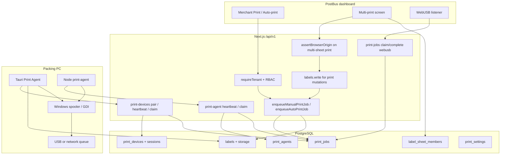
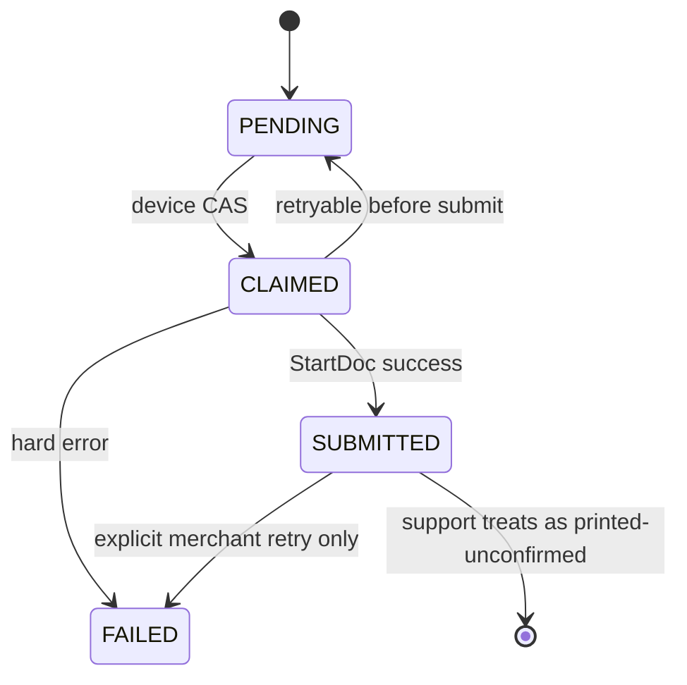

# POSTBUS PRINT AGENT AUDIT

**Date:** 18 October 2026  
**Auditor role:** principal architecture review (read-only)  
**Application:** PostBus (www.postbus.in)  
**Scope:** Direct printing, Print Agent (Node + Tauri), print queue, multi-print, WebUSB, pairing, tests  
**Constraints observed:** no application code changes, no schema changes, no production mutations, no live print jobs sent  

**Evidence classes used in this report**

| Class | Meaning |
| --- | --- |
| Code-verified | Confirmed by inspecting current repository files and line numbers |
| Unit-tested | Exercised by `vitest` in this audit session |
| Hardware-unverified | Requires a packing PC and a physical printer; not executed |

---

## SECTION 1 — Executive Summary

PostBus implements **cloud-queued, poll-based direct printing**, not a persistent WebSocket print channel. There are **two live agent implementations** plus a **browser WebUSB** path.

| Path | Location | OS | How jobs arrive |
| --- | --- | --- | --- |
| Tauri desktop agent (v0.2.0) | `print-agent-desktop/` | **Windows only** (NSIS) | HTTP poll every 3s to `print-devices/*` after pairing |
| Legacy Node agent | `print-agent/index.mjs` | Windows (pdf-to-printer / PowerShell); non-Windows listing is empty unless `pdf-to-printer` works | HTTP poll every 2s to `print-agent/*` with long-lived `pb_print_` token |
| WebUSB | `modules/print/webusb-provider.ts` + dashboard listener | Chromium + USB | Browser claims `delivery=webusb` jobs |

**Previous audit finding (VIEWER can print multi-sheet):** **fixed in the handler**, not in the route permission table. `POST label-template/multi-sheet` still maps to `labels.read` at the router, then `disposition === "print"` requires `labels.write` before persist/enqueue. Unit test `lets a VIEWER preview and download a multi-print sheet but not print` exists in `modules/labels/label-template-api.test.ts`.

**Previous persistence finding (sheet stored against first shipment only):** **partially mitigated.** `labels.shipment_id` and `print_jobs.shipment_id` still use the first member. `insertLabelSheetMembers` now writes all shipments to `label_sheet_members`.

**Physical printing is not proven.** `PRINTED` means the agent submitted a GDI/XPS document (`StartDocW` / `EndDoc`) or that `pdf-to-printer` returned success. There is no spooler job-complete callback and no page-eject sensor.

**Verdict:** see Section 17. Headline: **PRODUCTION READY WITH CONDITIONS** for Windows, single packing station, at-least-once delivery. **Not** production-ready as a cross-platform, exactly-once, barcode-certified print fabric.

Highest-priority risks:

1. Stale `PRINTING` jobs are reset to `PENDING` after 120s, which can **reprint a label that already entered the Windows spooler**.
2. Desktop printing **rasterizes PDF pages and stretches them** to named paper inches; barcode scan quality is hardware-unverified.
3. Jobs are claimed by **printer display name** across **all devices in the organization**.
4. Desktop UI still says pairing “does not print shipping labels yet” while a background thread **does** claim and print.
5. **macOS is not implemented** (`list_installed_printers` returns an error; bundle target is NSIS only).

---

## SECTION 2 — Actual Printing Architecture

### 2.1 Verified components

| Component | Path |
| --- | --- |
| V1 router | `lib/api/v1/handle.ts` |
| Agent (legacy) API | `lib/api/v1/print.ts` `handlePrintAgentRoutes` |
| Device pairing / new agent API | `lib/api/v1/print-devices.ts` |
| Station / WebUSB / label print | `lib/api/v1/print.ts` `handlePrintStationRoutes` |
| Label template / multi-sheet | `lib/api/v1/label-template.ts` |
| Queue + claim | `modules/print/service.ts` |
| Pairing crypto + in-memory spec | `modules/print/device-pairing.ts` |
| Pairing Postgres | `modules/print/device-pairing-db.ts` |
| WebUSB printers table | `modules/print/printers.ts` |
| Multi-print compose + print | `modules/labels/multi-up/render.ts` |
| Paper print gate | `modules/labels/multi-up/print.ts` |
| Sheet membership | `modules/labels/sheet-members.ts` |
| Auto-enqueue after label gen | `workers/processor.ts` |
| Dashboard station poll | `lib/hooks/use-print-station.ts` |
| Device UI | `components/dashboard/print-agent-devices.tsx` |
| Multi-print UI | `components/labels/multi-print-screen.tsx` |
| Route | `app/dashboard/labels/multi-print/page.tsx` |
| Schema | `supabase/migrations/20260923100000_auto_label_printing.sql`, `20260928224500_webusb_printers.sql`, `20261015120000_print_device_pairing.sql` |
| Updater | `modules/print-agent/updater.ts`, `app/api/v1/public/print-agent/updater/.../route.ts` |

### 2.2 Transport (verified, not assumed)

**HTTP short polling.** No WebSocket, SSE, or long-poll job channel exists in the agent or API.

- Desktop: `print-agent-desktop/src-tauri/src/lib.rs` spawns a thread that calls `print_queued_labels` then `sleep(3s)`.
- Node: `setInterval(..., 2000)` in `print-agent/index.mjs`.
- Dashboard connected status: `GET /api/v1/print-station` every 5s plus optional Realtime on `print_agents` and `print_jobs` (not `print_devices`).

### 2.3 Actual flow (verified)



### 2.4 Job status semantics (verified)

| Cloud status | Actual meaning |
| --- | --- |
| `PENDING` | Row exists; not owned |
| `PRINTING` | Claim succeeded (`claimed_at` set) |
| `PRINTED` | Agent reported success after OS submit API returned OK |
| `FAILED` | Agent or PDF load reported a non-retryable error |
| Dashboard `WAITING` | Mapped from `PENDING` or `PRINTING` in `printStatusForJob` |

There is **no** `DELIVERED_TO_AGENT`, **no** `SPOOLER_ACCEPTED` distinct from `PRINTED`, and **no** physical-complete state.

### 2.5 What the Print Agent is built with

- **Tauri 2** + React UI + Rust (`windows` / `windows-sys` crates).
- Identifier `in.postbus.print-agent`, product version `0.2.0`.
- Bundle targets: **`nsis` only**.
- Updater: signed Tauri updater, Windows x86_64 only (`resolvePrintAgentUpdate`).

---

## SECTION 3 — Windows Printing Audit

### 3.1 Discovery (code-verified)

`print-agent-desktop/src-tauri/src/printers.rs`:

- `EnumPrintersW` with `PRINTER_ENUM_LOCAL | PRINTER_ENUM_CONNECTIONS` and `PRINTER_INFO_2W`.
- USB vs network inferred from **port name** (`USB`, `IP_`, `WSD`, UNC, `TCP`, `HTTP`).
- Offline from spooler bits `0x80` / `WORK_OFFLINE 0x400`.
- Default from attribute `0x00000004`.
- `supports_pdf` is always `None` — the agent **does not** verify PDF capability.

Node agent: `pdf-to-printer` `getPrinters()`, else `Get-Printer` on Windows, else `[]`.

### 3.2 Job submission (code-verified)

Desktop `print_pdf.rs`:

1. `PdfDocument::LoadFromFileAsync` (Windows.Data.Pdf).
2. `RenderToStreamAsync` per page (PNG or BMP).
3. Decode pixels.
4. `CreateDCW("WINSPOOL", printer_name)`.
5. `StartDocW` / `StartPage` / `StretchDIBits` / `EndPage` / `EndDoc`.
6. Destination size = `paper_inches(paper_size) * printer DPI`.
7. `copies` repeats `StartPage` for **each PDF page**.

This is **not** “send PDF bytes to the driver.” It is **raster + stretch**. Thermal printers receive a bitmap at the driver’s current DEVMODE; the code **does not set paper size or orientation on the DEVMODE**.

Node fallback: `pdf-to-printer` with `scale: "noscale"`, then `Start-Process -Verb PrintTo`.

### 3.3 Discovery scenarios (code vs hardware)

| Scenario | Code evidence | Hardware |
| --- | --- | --- |
| Printer present before launch | Enumerated on each `list_printers` / poll | NOT RUN |
| Hot-plug after launch | Next 3s loop re-lists; UI refresh is manual | NOT RUN |
| Disconnect during print | `CreateDCW` / `StartDocW` errors; retryable if message matches offline/unavailable | NOT RUN |
| Rename | Jobs use **display name**, not `local_id` (`port\|name`) | NOT RUN |
| Default printer change | UI can fall back to default if saved name missing | NOT RUN |
| Two printers | Both listed; selection stored in `settings.json` and optionally pushed to `print_settings` | NOT RUN |
| Offline installed queue | Status `offline`; still selectable | NOT RUN |
| Paper support | Not queried from driver | NOT RUN |

**Identity stability:** `local_id` is `port|name` but cloud jobs store `printer_name` only. A rename or two queues with the same name can misroute jobs.

### 3.4 Unsupported / incomplete on Windows

- No USB VID/PID print path in the Tauri agent (WebUSB is browser-only).
- No confirmation the selected queue is a label printer vs “Microsoft Print to PDF”.
- Installer signing is optional (`print-agent-desktop/README.md`).

---

## SECTION 4 — macOS Printing Audit

**macOS is not a supported Print Agent platform in this repository.**

| Check | Evidence |
| --- | --- |
| Printer list | `#[cfg(not(windows))] list_installed_printers` → `"Printer discovery is implemented for Windows only."` (`printers.rs` lines 139–142) |
| Credentials | `#[cfg(not(windows))] save_credential` errors (`credentials.rs` 77–79) |
| Bundle | `tauri.conf.json` `"targets": ["nsis"]` |
| Updater | `target !== "windows" \|\| arch !== "x86_64"` → no manifest |
| Pairing payload | `platform: "windows"` hardcoded in `pairing.rs` `start_pairing` |
| Node agent | Non-Windows `listPrinters()` returns `[]` if `pdf-to-printer` fails |

CUPS is **not** integrated. Any macOS claim in older docs (`print-agent-provider.ts` comment about a `.dmg`) is **not implemented**.

**Verdict for macOS:** unsupported. Do not ship or market the current agent as cross-platform.

---

## SECTION 5 — Agent Connectivity Audit

### 5.1 Protocol

HTTPS JSON POST/PATCH/GET with Bearer tokens. Polling intervals: **2s (Node)** / **3s (Tauri)**.

Online windows:

- Legacy agent: `PRINT_AGENT_ONLINE_MS = 30_000`
- Paired device: `DEVICE_ONLINE_MS = 90_000`

### 5.2 Pairing lifecycle (Tauri)

1. `start_device_pairing` → `POST print-devices/pair/start` with 32-byte hex verifier.
2. UI polls `check_device_pairing` every 3s while `state === "pairing"`.
3. Merchant `POST print-devices/pair/approve` with 8-char code (`automation.manage`).
4. Agent `POST print-devices/pair/exchange` consumes challenge, inserts `print_devices`, issues `pb_pdev_` / `pb_pref_`.
5. Tokens stored in **Windows Credential Manager** (`CRED_PERSIST_LOCAL_MACHINE`).
6. Access TTL **15 minutes**, refresh TTL **90 days**.
7. Heartbeat + job claim use access token; refresh on “not connected”.
8. Revoke / disconnect sets `print_devices.status = revoked`. `deviceForAccess` rejects revoked devices.

### 5.3 Scenario matrix (code inference; not executed)

| Scenario | Expected from code | Tested here |
| --- | --- | --- |
| A. Agent before browser login | Pairing does not need merchant session; approve does | NOT RUN |
| B. Browser before agent | Station `connected=false` until heartbeat | NOT RUN |
| C. Browser closed, agent running | Agent independent of cookies | Code-verified |
| D. Temporary internet loss | ureq errors; next loop retries | NOT RUN |
| E. Agent restart | Credential Manager reload; poll resumes | Code-verified storage |
| F/G. Sleep/resume | No dedicated resume handler; online bit expires after 90s until next heartbeat | NOT RUN |
| H. Server restart | Next HTTP call fails then succeeds | NOT RUN |
| I. Access expiry | Heartbeat/claim refresh path | Unit tests on in-memory registry |
| J. Multiple dashboard tabs | Same queue; no per-tab lock | Code-verified |
| K. Multiple agents per org | Multiple `print_devices` allowed; **one** `print_agents` row per org; **shared** `print_settings.selected_printer_name` | Code-verified |

### 5.4 Stale ONLINE

`getPrintStation` treats a device as online if `last_seen_at` is within 90s **and** it reported at least one printer name. A crashed agent can remain “online” for up to 90s. Realtime invalidation listens to `print_agents`, not `print_devices`, so the dashboard depends on the 5s poll for paired-device freshness.

Heartbeat from a device can **write org `selected_printer_name`** if the current selection is empty or not in that device’s printer list (`heartbeatPrintDevice`).

### 5.5 Reconnection

No backoff. Fixed 3s/2s poll. No jitter. Rate limit on public device paths: 180/min for job/heartbeat (`handlePrintDevicePublicRoutes`).

---

## SECTION 6 — Direct Print API Audit

### 6.1 Entry points

| Action | Route | Permission |
| --- | --- | --- |
| Print existing label | `POST /api/v1/labels/:id/print` | `labels.write` (`v1-permissions` labels branch) |
| Custom label print | `POST /api/v1/label-template/custom-print` | `labels.write` |
| Official test print | `POST /api/v1/label-template/print-test` | `labels.write` |
| Multi-sheet | `POST /api/v1/label-template/multi-sheet` | Router: `labels.read`; print disposition: extra `labels.write` |
| Agent claim/pdf/complete | `print-agent/*`, `print-jobs/:id` | Agent bearer (admin client) |
| Device claim/pdf/complete | `print-devices/jobs/*` | Device bearer |
| WebUSB list/claim/complete | `GET print-jobs`, `POST print-jobs/:id/claim\|complete` | `labels.read` / `labels.write` |

Tenant binding uses **authenticated org**, not client-supplied `organization_id`.

### 6.2 Success messages vs reality

`handlePrintStationRoutes` for `labels/:id/print`:

- If agent connected: **"Sent to the printer."**
- Else: job remains pending; message says it will print when the printer reconnects.

`printCustomShippingLabel` / `print-test` / `printMultiUpSheet` similarly say “sent” when `station.connected` is true. That is **queued + likely claimable**, not physically printed.

### 6.3 Authorization gaps (code-verified)

- Route permission for multi-sheet remains `labels.read` (`lib/api/v1-permissions.ts` lines 45–49). Defense is **inside** `handleLabelTemplateRoutes` (lines 114–117). A future route that calls `printMultiUpSheet` without that check would regress.
- `GET print-station` and `GET print-devices` use `permission: undefined` (any signed-in member). Station payload includes `tokenPrefix` of the **legacy** agent token.
- WebUSB `GET print-jobs` is `labels.read` (viewers can see pending USB job ids, not PDFs unless they claim with `labels.write`).

### 6.4 CSRF / origin

Multi-sheet **print** requires matching `Origin` (`assertBrowserOrigin(..., true)`). Preview/download does not. Unit test `rejects a cross-origin print before storage or print jobs` exists.

---

## SECTION 7 — Multi-Print Integration Audit

**UI:** `/dashboard/labels/multi-print` → `MultiPrintScreen`  
**API:** `POST /api/v1/label-template/multi-sheet`

### 7.1 Composition

`renderMultiUpSheet` parses sheet, loads labels with concurrency 3, `composeMultiUpPdf`, returns members. `parseMultiUpRequest` caps **100 labels** (`MAX_LABELS`). Named paper sizes come from presets; client width/height for A4/A3/A6 are ignored in favor of presets (`label-template-api` test).

### 7.2 Print gate

`multiUpPrintDecision`:

- `custom` → preview/download only.
- Requires `station.connected`.
- Requires `agentPaper === sheetPaper`.

This still matches the documented custom-paper restriction.

### 7.3 VIEWER printing (previous finding)

**Current code:** VIEWER cannot enqueue. Handler check + UI `canWriteLabels`. Unit test covers this. **PASS as unit test** in `modules/labels/label-template-api.test.ts` (this session). Router still advertises `labels.read`.

### 7.4 Copies

`printMultiUpSheet` calls `enqueueManualPrintJob(..., { paperSize, copies: 1 })`. Label copies are expanded in the composed PDF. **Agent should print the PDF once.** Desktop still honors `claimed.copies`; cloud sets 1 for this path.

If `print_settings.copies` is 2–5, **non-multi** manual/auto jobs can still multiply pages (`enqueueManualPrintJob` uses `options?.copies ?? settings.copies`).

Frontend keeps an `Idempotency-Key` UUID for the print click (`multi-print-screen.tsx` 897–910). Two overlapping clicks before React `busy` can still mint **two keys** (`??=` race).

### 7.5 Shipment relationships

`persistLabelPdf` still inserts `shipment_id: rendered.shipmentId` (first member). `print_jobs.shipment_id` follows that label. `insertLabelSheetMembers` records all unique shipments. `labels.multi_sheet.print` audit log includes all shipment ids.

**Residual:** any consumer that only joins `labels.shipment_id` or `print_jobs.shipment_id` still sees one shipment.

### 7.6 Tests run this session

`modules/labels/multi-up/print-sheet.test.ts` **failed 4 tests** (`Can't embed page with missing Contents` from pdf-lib). That is a **broken test/fixture**, not proof that production compose is empty. `print.test.ts` paper-gate tests **passed**.

---

## SECTION 8 — Print Queue Reliability Audit

### 8.1 Storage and claim

Jobs live in `print_jobs`. Claim:

```
select PENDING limit 20
update ... where id = ? and status = PENDING
```

The update predicate is **atomic enough** for two claimers (loser gets no row). There is **no** `FOR UPDATE SKIP LOCKED` / Postgres queue function. Claim does **not** record `agentId` / `device_id` on the job.

AUTO jobs: unique index `print_jobs_auto_label_uidx` on `label_id` where `source = 'AUTO'`. MANUAL reprints always insert new rows.

### 8.2 Scenario results (code)

| # | Scenario | Code behavior | Guarantee |
| --- | --- | --- | --- |
| 1 | Single Print | One MANUAL insert | One job |
| 2 | Double-click | No server idempotency except multi-sheet key | **Duplicate jobs possible** |
| 3 | Browser retry | Multi-sheet: 2-minute idempotency if header present | Other print APIs: new job |
| 4 | Agent down before claim | Stays `PENDING` | Recoverable |
| 5 | Crash after claim before OS | Stays `PRINTING` until 120s, then `PENDING` | Recoverable; may reprint |
| 6 | Crash after spooler, before ACK | Same 120s reset | **Duplicate physical print** |
| 7 | Two agents claim | One wins `PENDING`→`PRINTING` | One owner of claim, **not** bound to a device id |
| 8 | Printer offline | Agent may PATCH `PENDING` with retry message | Waiting, can loop |
| 9 | PDF download fail | `loadPrintJobPdf` marks `FAILED` | Not retried |
| 10 | Rapid jobs | Ordered by `created_at` on claim | FIFO among claimable rows; one job per 3s loop on desktop |

### 8.3 Delivery guarantee

**At-least-once toward the spooler. Not exactly-once physical printing.**

`recoverStalePrintJobs` (`service.ts` 446–458, `PRINTING_STALE_MS = 120_000`) is the main duplicate driver.

Retryable agent errors (desktop: `offline`, `unavailable`, `not installed`, `could not open`) PATCH `PENDING` again — a missing printer name can **spin forever**.

No dead-letter besides `FAILED`. No job TTL cleanup migration found in this pass.

---

## SECTION 9 — Security and Tenant Isolation Audit

### 9.1 Strengths (code-verified)

- Agent/device tokens hashed (`hashSecret` / SHA-256 pairing hashes). Raw pairing code is not stored.
- Job PDF download scoped with `organization_id` on job **and** label.
- Cross-org PDF denied in `service.test.ts`.
- Pairing consume is `status=approved` CAS. Second org cannot approve an already-approved challenge for another org (memory registry tests; DB approve checks pending).
- Device org comes from the approved challenge, not the agent body.
- Revoked device cannot use access/refresh (`deviceForAccess` / `refreshPrintDevice`).
- Admin client used for agent routes; RLS still enabled on tables.
- Pairing challenges/sessions have **no** member SELECT policies (hashes not exposed to the dashboard JWT).
- Tauri CSP `default-src 'self'`. No local HTTP print server.
- Redirect follow in `pairing.rs` limited to `postbus.in` / `www.postbus.in`.
- `api_base` rejects non-HTTPS except localhost/127.0.0.1.

### 9.2 Issues

| ID | Severity | Issue |
| --- | --- | --- |
| PA-SEC-01 | HIGH | Any paired device in org A can claim **any** `delivery=agent` job whose printer name appears in **that** device’s list. No station lock. |
| PA-SEC-02 | MEDIUM | `completePrintJob` does not check which device claimed the job. Any org agent bearer who knows `jobId` can mark PRINTED/FAILED/PENDING. |
| PA-SEC-03 | MEDIUM | Legacy `pb_print_` token is long-lived until rotate; one token per org (`print_agents.organization_id` unique). |
| PA-SEC-04 | MEDIUM | `revokePrintDevice` does not delete `print_device_sessions` (disconnect-from-agent does). Access still fails via `status=revoked`. |
| PA-SEC-05 | MEDIUM | Label signed URLs created for **365 days** (`persist.ts` `SIGNED_URL_SECONDS`). Leak of `file_url` is a long-lived document leak. |
| PA-SEC-06 | LOW | `GET print-station` exposes `tokenPrefix`. |
| PA-SEC-07 | LOW | Job PDF filename `{shipment_id}.pdf`; bytes are full labels (PII). Temp files: `%AppData%\job-{id}.pdf` until delete. |
| PA-SEC-08 | LOW | `CRED_PERSIST_LOCAL_MACHINE` — other local users may read the generic credential. |
| PA-SEC-09 | INFO | Pairing start is unauthenticated (by design) + rate limited (8/10 min/IP). |

### 9.3 Cross-tenant tests

In-memory pairing tests **PASS** (`device-pairing.test.ts`). DB integration / live two-org tests: **NOT RUN**.

---

## SECTION 10 — PDF and Printer Compatibility Audit

Desktop path **always** rasterizes. Risks:

- `StretchDIBits` to a rectangle from `paper_inches` **ignores PDF aspect and claimed orientation**. Landscape custom snapshots (claimed as landscape in `claimNextPrintJob`) are still drawn into portrait A4/A6 inch boxes → **stretch/rotate errors**.
- Unknown paper sizes default to **A6 inches** (`print_pdf.rs` `_ => (4.13, 5.83)`).
- Windows.Data.Pdf default render resolution is not set in code; upscaling to 203–300 dpi thermal heads can blur barcodes.
- No `DEVMODE` paper; driver default tray/size used.
- Unicode (Malayalam/Hindi/Tamil) depends on PDF fonts/embed in the **already generated** label, then raster. Not separately tested.
- Node `pdf-to-printer` `noscale` is a different pipeline than Tauri raster — **two output behaviors** for the same cloud job.

**Automated:** PDF page size in compose tests, paper-name gate, copies=1 enqueue.  
**Requires hardware:** barcode scan, thermal 4×6 alignment, A4 multi-up, Unicode, USB vs network, driver-specific scaling.

---

## SECTION 11 — Performance Audit

No production latency measurements were taken (audit constraint).

Code findings:

- Multi-up PDF render pool size **3** (`PDF_RENDER_CONCURRENCY`).
- Desktop processes **one claimed job per 3s**.
- Claim reads up to **20** pending rows per poll.
- Dashboard `GET print-station` every **5s** per open session.
- 100-label sheet: 100 compose placements; memory is full PDF bytes in Node request + agent download.
- Heartbeat writes `last_printers` JSON every few seconds.
- No background worker for print jobs; agents **are** the workers.
- Auto print is inline in `workers/processor.ts` after label persist.

Recommendations (not implemented): measure p95 claim-to-`StartDocW`, bound PDF size, subscribe `print_devices` instead of only polling, add jittered backoff.

---

## SECTION 12 — Current Automated Test Coverage

Vitest run this session (print-related globs): **221 passed, 6 failed, 31 files**. Failures: `modules/labels/multi-up/print-sheet.test.ts` (4) and stale `.next-verify/standalone/modules/labels/label-template-api.test.ts` (2, missing Origin). Treat standalone copies as **out of scope / stale**.

### Required matrix

AUTHORIZATION

| Test | Class | Evidence |
| --- | --- | --- |
| VIEWER cannot initiate direct printing (multi-sheet) | **PASS** | `label-template-api.test.ts` VIEWER case |
| labels.write enforced on custom-print / print-test / labels print | **PASS** (permission map unit) | `v1-permissions.test.ts`; handler tests |
| Cross-tenant print requests rejected | **PASS** (unit mocks) | `service.test.ts` PDF org check; printers tenant tests |
| Route table still `labels.read` for multi-sheet | **PASS** as documentation of residual | `v1-permissions.ts` + test expects `labels.read` |

AGENT

| Test | Class | Evidence |
| --- | --- | --- |
| Agent registration / pairing | **PASS** | `device-pairing.test.ts` memory registry |
| Invalid credentials fail | **PASS** | `service.test.ts` authenticate |
| Revoked agents cannot claim | **PASS** (memory); DB revoke+claim | memory test; DB path code-verified **NOT RUN** e2e |
| Reconnection | **NOT IMPLEMENTED** as a test | poll loop only |
| Stale connections expire | **PASS** (unit) | `isPrintAgentOnline` / device 90s test |

PRINTER

| Test | Class | Evidence |
| --- | --- | --- |
| Printer discovery | **PASS** (port classify unit); **REQUIRES HARDWARE** for EnumPrinters | `printers.rs` tests |
| Disconnected printer | **NOT RUN** | retryable strings only |
| Paper mismatch rejected | **PASS** | `multi-up/print.test.ts` |
| Correct printer selected | **NOT RUN** | name match in claim unit |

QUEUE

| Test | Class | Evidence |
| --- | --- | --- |
| Duplicate AUTO jobs | **PASS** | `service.test.ts` |
| Duplicate MANUAL / double-click | **NOT IMPLEMENTED** | |
| Concurrent claims | **NOT IMPLEMENTED** (true concurrency); CAS update **PASS** in sequential mock | |
| Failed jobs traceable | **PASS** (status column) | |
| Retry after spooler | **NOT IMPLEMENTED** (unsafe retry is coded) | `recoverStalePrintJobs` test only checks reset |
| Agent crash no silent loss | **PASS** as PENDING recover; **FAIL** vs no-duplicate requirement | |

MULTI-PRINT

| Test | Class | Evidence |
| --- | --- | --- |
| A4 / A6 / A3 / 4x6 named print decision | **PASS** | `print.test.ts` |
| Rotation preserved in PDF | **NOT RUN** / limited layout tests | |
| Copies not multiplied twice | **PASS** (enqueue copies: 1) | `label-template-api` printCalls |
| 100-label limit | **PASS** | `request.test.ts` (not re-listed here; `MAX_LABELS` in request.ts) |
| Multi-shipment members | **PASS** unit `sheet-members.test.ts`; **FAIL** `print-sheet.test.ts` this run | |
| Custom cannot print | **PASS** | `print.test.ts` |

SECURITY

| Test | Class | Evidence |
| --- | --- | --- |
| Merchant A cannot access B jobs | **PASS** unit | `loadPrintJobPdf` org filter |
| Agent cannot bypass station ownership | **FAIL / NOT IMPLEMENTED** | no device_id on job |
| PDF access scoped | **PASS** unit | |
| Cross-tenant status updates | **PASS** if other org token; **FAIL** same-org other device | |

Desktop Rust tests: **NOT RUN** this session (would enumerate real printers / Credential Manager).

---

## SECTION 13 — Hardware Testing Requirements

**Not executed.** Do not treat raster code as a passing barcode test.

### Staging plan (test data only)

**Windows**

- Windows 10/11 x64 packing PC, manufacturer driver installed.
- PostBus Print Agent NSIS build matching updater channel.
- Pair via Settings → Printing.
- Printers: USB 4×6 thermal (e.g. Xprinter/Zebra class), USB or network A4, optional A3.
- Cases: plug order, unplug mid-job, rename queue, two printers, sleep/resume, agent restart, 10 sequential jobs, multi-up A4 with 8 labels, 4×6 official A6 vs 4×6 setting mismatch, Unicode address fixture, scan barcodes with a hardware scanner.
- Confirm dashboard “PRINTED” vs paper in tray.

**macOS**

- Record **unsupported**. Do not certify.

**Safety**

- Use synthetic orders. Do not print live customer PII to unapproved printers.
- Do not enable auto-print against production thermal printers during the first pass.

---

## SECTION 14 — Confirmed Bugs and Risks

Findings below are **code-verified** unless marked otherwise. No secrets included.

### PA-001 — Stale PRINTING requeue can duplicate physical prints

- **Severity:** HIGH  
- **File:** `modules/print/service.ts` — `recoverStalePrintJobs` lines 446–458; callers `heartbeatPrintAgent`, `claimNextPrintJob`  
- **Evidence:** update `PRINTING` → `PENDING` when `claimed_at < now-120s`  
- **Repro:** Claim job, `StartDocW` succeeds, kill agent before PATCH PRINTED; wait 120s; agent claims again.  
- **Impact:** Duplicate shipping labels.  
- **Root cause:** No distinct spooler-accepted state; timeout assumes the job never printed.  
- **Fix:** Terminal `PRINTING_UNCONFIRMED`; do not auto-reclaim after OS submit; require merchant reprint.  
- **Regression:** Stuck jobs need a manual retry UI.

### PA-002 — PRINTED is spooler submit, not physical completion

- **Severity:** HIGH (correctness / support)  
- **File:** `print-agent-desktop/src-tauri/src/print_pdf.rs` `submit_bitmap_to_driver` ~203–270; `lib.rs` 140–142  
- **Evidence:** success if `EndDoc > 0`; UI test copy already says paper is not confirmed (`App.tsx` 189)  
- **Repro:** Print to an offline queue that still accepts jobs.  
- **Impact:** Dashboard shows PRINTED with no paper.  
- **Fix:** Rename UX to “sent to Windows”; optional spooler watch.  
- **Regression:** Support scripts that trust PRINTED.

### PA-003 — PDF raster + StretchDIBits; orientation ignored

- **Severity:** HIGH (print quality)  
- **File:** `print_pdf.rs` `print_label_pdf` 43–64, `paper_inches` 66–74; `lib.rs` 138–140 (no orientation argument)  
- **Evidence:** Destination size from paper name only; landscape claim in `service.ts` 624 unused by Tauri.  
- **Repro:** Print landscape custom page or A4 sheet on Tauri agent; inspect stretch.  
- **Impact:** Unreadable barcodes, wrong layout.  
- **Fix:** Print PDF via a PDF-aware path or set DEVMODE + preserve aspect; pass orientation.  
- **Regression:** Thermal margins. **REQUIRES HARDWARE** to confirm.

### PA-004 — Org-wide printer name routing

- **Severity:** HIGH (multi-station)  
- **File:** `claimNextPrintJob` 547–630; `printTarget` 130–140; `heartbeatPrintDevice` 227–239  
- **Evidence:** No `device_id` on `print_jobs`; any device listing the selected name can claim.  
- **Repro:** Two PCs both report `XP-420B`; either may print.  
- **Impact:** Labels at the wrong desk; possible cross-station PII.  
- **Fix:** Bind jobs to `print_devices.id`; per-station default printer.  
- **Regression:** Single-PC merchants must select a station.

### PA-005 — Desktop UI contradicts printing

- **Severity:** MEDIUM (ops / trust)  
- **File:** `print-agent-desktop/src/App.tsx` line 74 vs `lib.rs` `print_queued_labels` 112–157  
- **Evidence:** “This connection does not print shipping labels yet.” while claim/print loop runs.  
- **Repro:** Pair agent, enqueue job, observe print while UI denies the feature.  
- **Impact:** Mis-support, merchants using Node agent instead, or ignoring errors.  
- **Fix:** Align copy with Phase 2 behavior.  
- **Regression:** none.

### PA-006 — Router permission still labels.read for multi-sheet

- **Severity:** MEDIUM (defense in depth)  
- **File:** `lib/api/v1-permissions.ts` 45–49; mitigation `label-template.ts` 114–117  
- **Evidence:** `v1-permissions.test.ts` expects `labels.read`.  
- **Repro:** Add a new caller of `printMultiUpSheet` without the write check.  
- **Impact:** VIEWER print regression.  
- **Fix:** Split routes or inspect body before `requireTenant` (harder) / `labels.write` when `Idempotency-Key`+print. Simplest: `multi-sheet` print as separate path.  
- **Regression:** VIEWER preview must stay `labels.read`.

### PA-007 — MANUAL print not idempotent; multi-sheet key race

- **Severity:** HIGH  
- **File:** `enqueueManualPrintJob` 501–544; `multi-print-screen.tsx` 897–910  
- **Evidence:** each POST inserts; `??=` UUID not atomic across double invoke.  
- **Repro:** Double-click Print (single label or two overlapping multi-print handlers).  
- **Impact:** Duplicate labels.  
- **Fix:** Disable synchronously; server idempotency for all MANUAL prints.  
- **Regression:** intentional reprints need a new key.

### PA-008 — “Sent to the printer” on enqueue

- **Severity:** MEDIUM  
- **File:** `lib/api/v1/print.ts` 172–177; `render.ts` 134–139 (`connected: true` hardcoded after decision)  
- **Impact:** False operational success.  
- **Fix:** Return `queued` vs `claimed`.  
- **Regression:** toast copy.

### PA-009 — Printer identity is display name

- **Severity:** MEDIUM  
- **File:** `printers.rs` `local_id`; jobs use `printer_name`  
- **Impact:** Rename / duplicate names.  
- **Fix:** Persist `local_id` and require exact match.

### PA-010 — macOS unimplemented

- **Severity:** MEDIUM (product scope)  
- **File:** `printers.rs` 139–142; `tauri.conf.json` bundle targets  
- **Impact:** Failed Mac installs.  
- **Fix:** Do not ship Mac; or implement CUPS later.

### PA-011 — Retryable “not installed” infinite PENDING

- **Severity:** MEDIUM  
- **File:** `lib.rs` 145–153  
- **Impact:** Queue never fails; silent wait.  
- **Fix:** Fail after N attempts.

### PA-012 — PDF download failure is terminal FAILED

- **Severity:** MEDIUM  
- **File:** `loadPrintJobPdf` 752–761  
- **Impact:** Transient storage blip kills the job.  
- **Fix:** Bounded retry.

### PA-013 — Year-long signed URLs

- **Severity:** MEDIUM  
- **File:** `modules/labels/persist.ts` line 11  
- **Impact:** Stolen `file_url` remains valid.  
- **Fix:** Short-lived agent download only (already has job PDF endpoint).

### PA-014 — README / provider comments stale

- **Severity:** LOW  
- **File:** `print-agent-desktop/README.md` (Phase 1, no pairing); `print-agent-provider.ts` “does not print by itself”  
- **Impact:** Wrong operator runbooks.

### PA-015 — print-sheet unit tests currently FAIL

- **Severity:** MEDIUM (CI signal)  
- **File:** `modules/labels/multi-up/print-sheet.test.ts`  
- **Evidence:** this session, pdf-lib `MissingPageContentsEmbeddingError`  
- **Impact:** Membership/idempotency tests do not protect CI.  
- **Class:** FAIL (tests), not proven production compose bug.

### PA-016 — Dual agent pipelines

- **Severity:** MEDIUM  
- **Evidence:** Node Sumatra/PrintTo vs Tauri GDI raster  
- **Impact:** Inconsistent output for the same job depending which agent is online (`printTarget` prefers any online `print_devices`).

---

## SECTION 15 — Recommended Fix Architecture

Do not implement until approved. Suggested target:

1. **Station as first-class:** `print_jobs.device_id`, claim `WHERE device_id = auth.device`. Org default station in UI.  
2. **Job state machine:** `PENDING → CLAIMED → SUBMITTED_TO_SPOOLER → PRINTED_UNCONFIRMED` (optional) / `FAILED` / `CANCELLED`. Never auto-move `SUBMITTED_*` back to `PENDING`.  
3. **Idempotency:** all dashboard print POSTs require `Idempotency-Key`; unique `(organization_id, key)`.  
4. **Print path:** prefer driver-native PDF (or fixed 300 dpi render without aspect stretch); set DEVMODE paper; copies=1 unless whole-document copies documented.  
5. **Permissions:** `POST .../multi-sheet/print` → `labels.write`; preview stays read.  
6. **Observability:** metrics for queue depth, claim latency, fail codes, online devices; structured job id in Sentry.  
7. **Platform:** Windows GA; macOS explicit “not supported”.  
8. **Retire or wrap** the Node token agent behind the same device pairing.



---

## SECTION 16 — Prioritized Implementation Plan

1. **P0** Stop auto-reclaim after OS submit (PA-001). Honest status copy (PA-002, PA-005, PA-008).  
2. **P0** Bind jobs to `device_id` (PA-004).  
3. **P0** Idempotent MANUAL print + fix double-click (PA-007).  
4. **P1** Print pipeline: no stretch; honor orientation; paper DEVMODE (PA-003). Hardware barcode gate.  
5. **P1** Split multi-sheet print permission at the router (PA-006).  
6. **P1** Repair `print-sheet.test.ts` (PA-015).  
7. **P2** Short signed URLs; session delete on revoke; fail-fast missing printer (PA-011–014).  
8. **P2** Metrics and `print_devices` Realtime.  
9. **P3** macOS only if product requires it; otherwise documentation freeze.

---

## SECTION 17 — Production Readiness Verdict

### **PRODUCTION READY WITH CONDITIONS**

**Why not PRODUCTION READY:** exactly-once printing, macOS, barcode certification, and multi-station isolation are not established. Stale-job reclaim can duplicate labels. Physical output was **not** tested in this audit.

**Why not NOT PRODUCTION READY:** tenant PDF isolation, pairing hashes, VIEWER multi-print block, custom-paper print block, copies=1 on multi-sheet enqueue, atomic PENDING→PRINTING claim, and Windows printer enumeration exist in code and (mostly) unit tests. A **single Windows packing PC** with unique printer names can operate as an at-least-once queue.

**Why not INSUFFICIENT EVIDENCE alone:** architecture, auth, and queue behavior are inspectable. Hardware quality remains insufficiently evidenced and is called out as a **condition**, not a pass.

**Conditions for continued production use**

1. Windows only; Tauri agent preferred over documenting macOS.  
2. One active packing computer (or uniquely named printers) per organization.  
3. Operators treat `PRINTED` as “sent to Windows,” not “label on the parcel.”  
4. Accept possible duplicates after agent crash mid-print; prefer reprint from dashboard rather than silent timeout reclaim (until PA-001 is fixed).  
5. Barcode scan QA on each printer model before go-live of that device.  
6. VIEWER must not get a new print API that skips the handler check.  
7. Do not send live customer labels to lab printers.

**Evidence remaining:** sleep/resume, USB hotplug, thermal 4×6 vs A4, Unicode, updater install, two-agent claim under load — all **NOT RUN**.

---

## SECTION 18 — Proposed Cursor Implementation Prompts

Use only after explicit approval. One prompt per change set.

**Prompt 1 — Stop duplicate reclaim**  
“In `modules/print/service.ts`, do not reset jobs to PENDING after the agent has reported spooler submit. Add status `SUBMITTED` or `UNCONFIRMED` and a merchant reprint endpoint. Add unit tests for crash-after-EndDoc. Do not change India Post booking.”

**Prompt 2 — Device-bound claim**  
“Add `print_jobs.device_id` (migration only when approved). `claimNextPrintJob` for paired devices must only claim rows for that device. Update Tauri heartbeat to keep device id. Tests for two devices same printer name.”

**Prompt 3 — Print UX truthfulness**  
“Replace ‘Sent to the printer’ / App.tsx ‘does not print yet’ with queued/claimed language. Keep WebUSB messages distinct.”

**Prompt 4 — Idempotent MANUAL print**  
“Require Idempotency-Key on `enqueueManualPrintJob` callers; unique constraint. Fix multi-print client to set the key before await.”

**Prompt 5 — Router permission**  
“Introduce `POST label-template/multi-sheet/print` with `labels.write`; keep preview/download on read. Update `v1-permissions.test.ts`.”

**Prompt 6 — GDI print quality**  
“Change `print_label_pdf` to preserve PDF page aspect, honor orientation, and set printer paper. Do not StretchDIBits a landscape page into portrait A4 inches. Provide a hardware test checklist; do not claim barcode PASS without a scan.”

**Prompt 7 — Fix print-sheet tests**  
“Repair `print-sheet.test.ts` empty-page pdf-lib embed so membership and idempotency assertions run in CI.”

---

## Appendix A — Heartbeat / online constants

| Constant | Value | File |
| --- | --- | --- |
| `PRINT_AGENT_ONLINE_MS` | 30s | `modules/print/service.ts` |
| `DEVICE_ONLINE_MS` | 90s | `modules/print/device-pairing.ts` |
| `PRINTING_STALE_MS` | 120s | `modules/print/service.ts` |
| `ACCESS_TTL_MS` | 15 min | `device-pairing.ts` |
| `REFRESH_TTL_MS` | 90 days | `device-pairing.ts` |
| `PAIRING_TTL_MS` | 10 min | `device-pairing.ts` |
| Desktop poll | 3s | `lib.rs` |
| Node poll | 2s | `print-agent/index.mjs` |
| Dashboard poll | 5s | `use-print-station.ts` |

## Appendix B — What this audit did not do

- No production or staging print jobs.  
- No Tauri `cargo test` on a packing PC.  
- No NSIS install.  
- No barcode scanner.  
- No macOS VM.  
- No Coolify/production log query.  
- No schema or code modifications (report file only).
