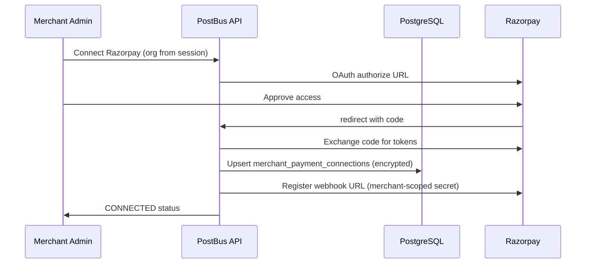
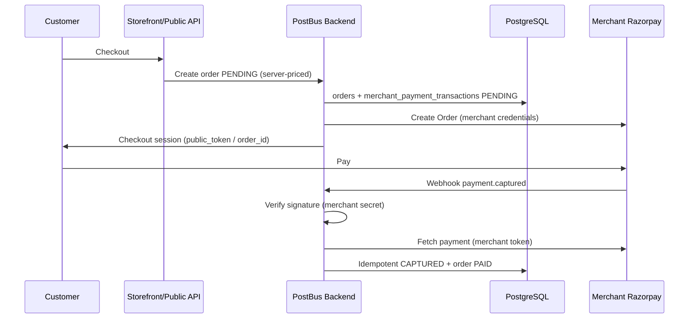

# PostBus — Multi-Tenant Razorpay Merchant Payment Integration

## Pre-Implementation Audit Report

**Audit date:** 2026-10-10  
**Scope:** Read-only codebase and schema inspection (no production changes, no live payment calls)  
**Repository root:** `d:\POST BUS APP` (main tree; worktrees ignored unless noted)  
**Production URL (context only):** https://www.postbus.in — **NOT VERIFIED** against live deployment from this audit

---

## SECTION A — Executive Summary

### Current architecture (verified)

PostBus is a **Next.js 16** multi-tenant SaaS app using **Supabase (PostgreSQL + Auth + RLS)** for data, **BullMQ/Redis** for background jobs, and a unified **`/api/v1`** tenant API with **`requireTenant()`** deriving `organizationId` from `profiles.active_organization_id` plus `organization_members` membership (not from client-supplied org IDs alone).

**Domain A — Platform Razorpay (PostBus billing)** is implemented and production-oriented:

- Single PostBus Razorpay account credentials in `platform_settings` (encrypted) with env fallbacks (`RAZORPAY_*`).
- HTTP client: `modules/razorpay/client.ts` (raw `fetch` to `https://api.razorpay.com/v1`; **no** official `razorpay` npm package in `package.json`).
- Checkout: Razorpay **Orders** for subscription periods and AI Credits (`modules/billing/subscriptions.ts`, `modules/ai-credits/service.ts`).
- Webhook: **`POST /api/webhooks/razorpay`** → `app/api/webhooks/razorpay/route.ts` → `processRazorpayEvent()` in `modules/billing/webhooks.ts`.
- Platform payment rows live in **`public.payments`** (subscription + AI credits); webhook dedupe in **`public.razorpay_webhook_events`**.

**Domain B — Merchant customer payments** for WhatsApp Store / inventory orders is **not** integrated with Razorpay today:

- Storefront payments use **manual UPI/GPay/QR** (`storefront_settings.upi_id`, `gpay_number`, `qr_image_path`) and **merchant-confirmed claims** (`order_payment_claims`, `resolve_whatsapp_payment_claim` RPC).
- India Post **COD** is declared at booking time (`modules/india-post/booking-payload.ts` → `paymentMode` / `codr_cod`); collection is **India Post → merchant**, not Razorpay.

There is **no** `merchant_payment_connections` table or merchant Razorpay module in migrations (only mentioned in `.cursor/plans/shopify_embedded_app_53eff4cb.plan.md` as a future design sketch).

### Merchant integration feasibility

| Model | Fit for “settlement to merchant Razorpay account” | Verified in Razorpay docs |
| --- | --- | --- |
| **Technology Partner OAuth** (sub-merchant authorizes PostBus; API calls with per-merchant `access_token` / Checkout with `public_token`) | **Best fit** — funds settle in merchant’s Razorpay account; PostBus does not become payee | Yes ([Razorpay OAuth for Technology Partners](https://razorpay.com/docs/partners/technology-partners/onboard-businesses/integrate-oauth/)) — **partner enrollment NOT VERIFIED** for PostBus |
| **Merchant API keys** (per-tenant `key_id` + `key_secret` stored encrypted, same as WATI/India Post pattern) | **Works technically** — settlement to merchant; higher credential risk and ops burden | Standard Razorpay merchant API — supported |
| **Razorpay Route / linked accounts** | **Poor fit** — typically platform account receives payment then splits; conflicts with “PostBus must not receive merchant sales” | Documented for marketplaces — **not recommended** for this requirement |

**Recommendation:** Pursue **OAuth as primary** if PostBus is (or becomes) a Razorpay Technology Partner; implement **manual key onboarding** only as a controlled fallback with stricter audit and rotation policies.

### Major findings

1. **No isolation boundary yet** between platform and merchant Razorpay — one client (`getRazorpayCredentials()`), one webhook URL, one `payments` table without `provider` / `domain` discriminator.
2. **Platform webhook handler** routes `payment.captured` to **AI Credits first**, then subscriptions (`modules/billing/webhooks.ts`) — any merchant payment event on the same webhook secret would be dangerous.
3. **Strong tenant patterns exist** for other integrations (`wati_connections`, `india_post_connections`, encrypted secrets via `lib/security/crypto.ts`, RLS with `is_org_member` / `has_org_role`) — merchant Razorpay should mirror this, not extend `platform_settings`.
4. **WhatsApp prepaid** today is **trust-but-verify manual** (customer claims payment; merchant confirms) — Razorpay must replace or augment this with **server-side capture verification** only.
5. **`platform_settings` RLS** allows `SELECT` to **all** roles (`using (true)`) with `GRANT SELECT` to `anon, authenticated` — encrypted platform secrets are **readable via direct Supabase client** if columns are selected (**HIGH**; see Section I).
6. **`refundRazorpayPayment`** exists in `modules/razorpay/client.ts` but has **no production call sites** in the main tree — platform refunds appear webhook-driven only.

### Overall risk level

**Pre-implementation program risk: MEDIUM–HIGH**  
**GO/NO-GO for starting implementation:** **YELLOW** (Section L)

---

## SECTION B — Verified Codebase Findings

### B.1 Dependencies and environment

| Item | Location | Responsibility |
| --- | --- | --- |
| Razorpay API (HTTP) | `modules/razorpay/client.ts` | Platform-only today; Basic auth from `getRazorpayCredentials()` |
| Config loader | `modules/razorpay/config.ts` | `platform_settings` + env; `getRazorpayWebhookSecret()`, `RAZORPAY_BILLING_WEBHOOK_EVENTS` |
| Signatures | `modules/razorpay/signature.ts` | Order/subscription checkout HMAC; webhook body HMAC |
| Super Admin Razorpay UI/API | `modules/razorpay/admin-settings.ts`, `app/(admin)/admin/razorpay/page.tsx`, `lib/api/admin/handle.ts` | Save keys, test ping, register webhook |
| Env vars | `lib/env.ts`, `.env.example` | `RAZORPAY_KEY_ID`, `RAZORPAY_KEY_SECRET`, `RAZORPAY_WEBHOOK_SECRET`, `NEXT_PUBLIC_RAZORPAY_KEY_ID` |
| CSP | `lib/security/headers.ts` | Allows `checkout.razorpay.com`, `api.razorpay.com` |
| Webhook registration script | `scripts/register-razorpay-webhook.mjs` | Points webhook to `/api/webhooks/razorpay` |
| Docs | `docs/billing.md` | Platform billing API and webhook behavior |

**Not present:** `razorpay` npm SDK; merchant Razorpay modules; separate webhook routes.

### B.2 Platform billing services

| Component | Path | Responsibility | Security boundary |
| --- | --- | --- | --- |
| Subscribe / verify checkout | `modules/billing/subscriptions.ts` — `startCheckout`, `verifyCheckout`, `activateSubscription` | Creates Razorpay order, inserts `payments`, verifies signature with **platform** secret, fetches payment from Razorpay | Uses `writeClient()` = service role; org from `TenantContext` |
| Billing HTTP | `lib/api/v1/billing.ts` | Routes `billing/subscribe`, `billing/verify`, `billing/ai-credits/checkout`, etc. | `POST billing/*` requires tenant + permissions |
| AI Credits checkout | `modules/ai-credits/service.ts` — `startAiCreditsCheckout`, `fulfillCapturedAiCreditPayment` | Platform order; `billing_cycle` = `AI_CREDITS_BILLING_CYCLE`; RPC `fulfill_ai_credit_purchase` | Idempotent grant; org guard in RPC/legacy path |
| Webhook processor | `modules/billing/webhooks.ts` — `processRazorpayEvent` | Subscriptions, `payment.captured`, `payment.failed`, `refund.processed` | Service role; matches subscription by `razorpay_subscription_id` / `razorpay_order_id` |
| Webhook route | `app/api/webhooks/razorpay/route.ts` | Raw body signature, insert `razorpay_webhook_events`, process | **Single** platform webhook secret |
| Cron | `modules/billing/cron.ts` | Billing maintenance (**not fully traced in this audit**) | Service role |
| Checkout UI | `components/billing/checkout-button.tsx`, `components/billing/ai-credits-checkout-button.tsx` | Loads Razorpay Checkout.js; calls `/api/v1/billing/*` | Only `keyId` exposed to browser |

### B.3 Database (platform payments) — verified migrations

| Table | Migration | Purpose |
| --- | --- | --- |
| `platform_settings` | `20260924120000_billing_razorpay.sql`, `20260924200000_platform_razorpay_credentials.sql` | Trial flags + **platform** Razorpay credentials |
| `plans`, `subscriptions`, `payments` | `20260924120000_billing_razorpay.sql` | SaaS billing |
| `razorpay_customers` | same | Org → Razorpay customer for **platform** billing |
| `razorpay_webhook_events` | same | Platform webhook idempotency |
| `subscription_history`, `billing_audit_logs`, `billing_usage` | same | Audit and usage |
| `subscriptions.razorpay_order_id` | `20260925013000_subscription_razorpay_order.sql` | Checkout order linkage |
| AI credit wallet / fulfill RPC | `20261008120000_ai_credits.sql`, `20261008180000_ai_credit_wallet.sql` | Credits purchase idempotency on `payments.razorpay_order_id` |

**Indexes (verified):**

- `payments_razorpay_payment_id_uidx` (partial unique on `razorpay_payment_id`)
- `payments_ai_credits_razorpay_order_id_uidx` (partial unique for AI credits billing cycle)
- `subscriptions_razorpay_order_id_uidx`

**RLS (verified):** `payments` — **SELECT only** for org members (`payments_tenant_select`); writes via service role. No `INSERT` policy for tenants on `payments`.

### B.4 Tenant / organization model

| Mechanism | Path / object | Notes |
| --- | --- | --- |
| Active org | `lib/api/context.ts` — `requireTenant()` | From `profiles.active_organization_id` + membership |
| RLS helpers | Supabase functions `is_org_member`, `has_org_role`, `is_platform_admin` | Used across integrations |
| Integration credentials pattern | `supabase/migrations/20260922001500_wati_connections.sql`, `20260919090200_integrations_platform.sql` (`india_post_connections`) | `organization_id` unique, encrypted secrets, `integration_status`, OWNER/ADMIN write |
| Integrations API | `lib/api/v1/integrations.ts` | Large handler; Shopify OAuth, WATI, India Post, Vachat — **no Razorpay** |
| Integrations UI | `app/dashboard/integrations/page.tsx` | Cards: Shopify, India Post, WATI, PostBus WhatsApp, Vachat — **no Razorpay card** |

### B.5 WhatsApp Store / orders / payments (non-Razorpay)

| Component | Path | Responsibility |
| --- | --- | --- |
| Order payment math | `modules/orders/payment.ts` — `settleOrderPayment`, `shipmentCollectFromOrder` | `PENDING`, `PAID`, `PARTIAL`, `COD`, `REFUNDED`, `FAILED` |
| Payment statuses | `types/domain.ts` — `PAYMENT_STATUSES` | Business-level order payment states |
| WhatsApp lifecycle | `modules/orders/whatsapp-lifecycle.ts` | Commands, payment claims, merchant confirm/reject, UPI details from `storefront_settings` |
| Payment claims table | `supabase/migrations/20261007140000_whatsapp_order_payment.sql` | Manual payment proof workflow |
| Claim resolution RPC | `supabase/migrations/20261008010000_whatsapp_p0_p1_guards.sql` — `resolve_whatsapp_payment_claim` | Atomic confirm/reject; **service_role** (grant to authenticated added in `20261008011000_whatsapp_payment_rpc_authenticated.sql` for dashboard) |
| Public storefront orders | `modules/customer-order-links/public.ts` | Creates `IMPORTED` WhatsApp orders; metadata `storefront.paymentPreference`; notifies merchant — **no gateway** |
| Storefront settings | `supabase/migrations/20261007140000_whatsapp_order_payment.sql` | Merchant UPI/GPay/QR (explicitly not PostBus billing) |
| India Post COD booking | `modules/india-post/booking-payload.ts` | COD vs PREPAID on shipment articles |

### B.6 Webhook security (platform) — verified behavior

1. Reads **raw body** (`request.text()`).
2. Verifies `x-razorpay-signature` with `verifyWebhookSignature(raw, signature, secret)`.
3. Dedupes via `razorpay_webhook_events.event_id` (`razorpayWebhookEventId` fallback hashes body prefix).
4. On unique violation → `200` duplicate.
5. Processing failures → `500` (Razorpay retries) and row `status = failed`.

**Gaps for merchant domain:** no per-tenant secret selection; no `account_id` / `key_id` routing; `payment.captured` without subscription still hits AI credits path.

### B.7 Refunds

- Webhook: `refund.processed` updates `payments.status = REFUNDED` by `razorpay_payment_id` (`modules/billing/webhooks.ts`).
- API: `refundRazorpayPayment` in `modules/razorpay/client.ts` — **unused** in app code (verified via ripgrep on main tree).

### B.8 Background processing

- `workers/index.ts` — BullMQ workers for shipment booking etc.; **no dedicated payment reconciliation worker** found for Razorpay.

---

## SECTION C — Existing Payment Architecture (Domain A)

### Flow: Subscription purchase

1. Owner calls `POST /api/v1/billing/subscribe` → `startCheckout()` (`lib/api/v1/billing.ts`).
2. Service role creates/updates `subscriptions`, calls `createRazorpayOrder()` with notes `organization_id`, `subscription_id`, `plan_id`.
3. Inserts `payments` row `PENDING` with `razorpay_order_id`.
4. Browser opens Razorpay Checkout with platform `keyId`.
5. Client calls `POST /api/v1/billing/verify` → signature check with platform secret → `fetchRazorpayPayment` → `fulfillCapturedAiCreditPayment` **or** subscription activation.
6. Parallel path: `POST /api/webhooks/razorpay` on `payment.captured` / subscription events.

### Flow: AI Credits

1. `POST /api/v1/billing/ai-credits/checkout` → `startAiCreditsCheckout()` inserts `payments` with `billing_cycle = AI_CREDITS_BILLING_CYCLE`.
2. Fulfillment: webhook `payment.captured` or verify path → `fulfill_ai_credit_purchase` RPC (preferred) with amount and org checks.

### Regression coupling points (must not share with merchant)

| Shared artifact | Risk if reused for merchant |
| --- | --- |
| `modules/razorpay/client.ts` | Wrong credentials → wrong settlement account |
| `getRazorpayConfig()` | Merchant charges on PostBus account |
| `public.payments` | Merchant revenue mixed with SaaS invoices; AI credit mis-grant |
| `processRazorpayEvent()` | Merchant `payment.captured` could activate subscriptions or grant AI credits |
| `/api/webhooks/razorpay` | Wrong secret / cross-domain events |
| Checkout components | Wrong `keyId` |

**Required:** Separate modules (`modules/merchant-payments/` or `modules/razorpay-merchant/`), tables, webhook route, and client factory `getMerchantRazorpayClient(organizationId)`.

---

## SECTION D — Multi-Tenant Security Assessment

### Existing strengths (verified)

- Tenant API derives org from auth + membership (`lib/api/context.ts`).
- Integration secrets stored with `encryptSecret` / `decryptSecret` (`lib/security/crypto.ts`); production requires `INTEGRATION_ENCRYPTION_KEY`.
- Per-org integration rows with RLS (WATI, India Post).
- Order queries consistently filter `organization_id` in services (e.g. `whatsapp-lifecycle.ts` CAS updates).
- AI credit fulfillment checks `organization_id` mismatch (`forbidden` flag).
- WhatsApp payment RPC requires matching `p_organization_id` and `p_order_id`.

### Gaps relevant to merchant payments

| Gap | Severity | Evidence |
| --- | --- | --- |
| No merchant payment tables / APIs | BLOCKER for production | No `merchant_payment_*` in `supabase/migrations` |
| Platform `payments` lacks domain discriminator | HIGH | `20260924120000_billing_razorpay.sql` schema |
| Single webhook endpoint and processor | HIGH | `app/api/webhooks/razorpay/route.ts` |
| `platform_settings` readable broadly | HIGH | `platform_settings_admin_select` `using (true)` + grant to authenticated |
| Public storefront has no payment amount enforcement server-side beyond quote at order create | MEDIUM | `customer-order-links/public.ts` — payment still manual after create |
| Webhook tenant resolution not designed for N merchants | HIGH | Must not use unauthenticated payload `notes.organization_id` alone |

### IDOR / BOLA tests to automate (recommended)

1. Tenant A cannot `GET/PATCH /api/v1/integrations/razorpay` for org B (once built).
2. Tenant A cannot create checkout for order belonging to org B.
3. Tenant A cannot verify payment with org B’s `razorpay_order_id`.
4. Webhook with valid signature for merchant B must not update org A order (signature ties to merchant connection).
5. Service role jobs must always include `organization_id` from DB row, never from job payload alone without check.
6. Direct Supabase: authenticated user cannot `select encrypted_*` from `platform_settings` or `merchant_payment_connections` (column-level or view-based restriction).

---

## SECTION E — Merchant Razorpay Integration Architecture (Recommended)

### E.1 Connection models

**Primary: Razorpay OAuth (Technology Partner)**

- Register OAuth app on Razorpay Partner Dashboard (**partner status: NOT VERIFIED** for PostBus).
- Merchant flow: Integrations → Razorpay → Connect → redirect to Razorpay → `authorization_code` → server exchanges for `access_token`, `refresh_token`, `public_token` ([integration steps](https://razorpay.com/docs/partners/technology-partners/onboard-businesses/integrate-oauth/integration-steps)).
- Store per org: `razorpay_account_id`, encrypted `access_token`, encrypted `refresh_token`, `public_token`, `token_expires_at`, scopes, `status`, `last_verified_at`.
- Checkout: use merchant `public_token` as Razorpay `key` ([process payments doc](https://razorpay.com/docs/partners/technology-partners/process-payments/)).
- Server verification: Bearer `access_token` for Orders/Payments APIs; signature verification uses **merchant’s** OAuth app secret / account context per Razorpay docs for that flow.
- Subscribe to `account.app.authorization_revoked` on **merchant** webhook configuration.
- **Token rotation:** 90-day access token TTL — scheduled refresh job per connection.

**Fallback: Manual API keys**

- Mirror `wati_connections`: `key_id`, `encrypted_key_secret`, optional `encrypted_webhook_secret`, `webhook_id`.
- Verification: `pingRazorpayApi` equivalent with merchant keys.
- **Implications:** Merchant must generate keys; higher phishing risk; revocation = merchant rotates keys in dashboard; PostBus must detect 401 and mark connection `DISCONNECTED`.

**Explicitly avoid:** Using PostBus platform keys for merchant orders. **Avoid Route** unless product requirement changes to platform-collected funds.

### E.2 Connection lifecycle (conceptual)

### E.3 Payment data flow (prepaid store order)

---

## SECTION F — Database Design (Proposal — NOT IMPLEMENTED)

Use **separate tables** from `public.payments` to prevent AI credit / subscription conflation.

### F.1 `merchant_payment_connections`

| Column | Notes |
| --- | --- |
| `organization_id` | PK, FK `organizations` |
| `provider` | `RAZORPAY` enum |
| `auth_mode` | `OAUTH` \| `API_KEY` |
| `razorpay_account_id` | From OAuth |
| `key_id` / `public_token` | For Checkout display |
| `encrypted_access_token` / `encrypted_key_secret` | Never expose to client |
| `encrypted_refresh_token` | OAuth only |
| `encrypted_webhook_secret` | Per-merchant webhook |
| `webhook_id` | Razorpay webhook entity id |
| `status` | `integration_status` |
| `prepaid_enabled` | Feature flag |
| `last_verified_at`, `last_error` | |

**RLS:** SELECT `is_org_member`; INSERT/UPDATE/DELETE `has_org_role(OWNER, ADMIN)` — same as `wati_connections`.

**Credentials:** No SELECT of `encrypted_*` for authenticated roles — expose via security-barrier view or API-only server reads.

### F.2 `merchant_payment_transactions`

Link to `orders.id`, store `amount_paise`, `currency`, `gateway_order_id`, `gateway_payment_id`, `status` (internal enum), `payment_method`, `verified_at`, `idempotency_key`.

**Constraints:**

- Unique `(organization_id, gateway_payment_id)` where not null
- Unique `(organization_id, gateway_order_id)` where not null
- FK `(organization_id, order_id)` → `orders(organization_id, id)` if composite FK pattern used elsewhere

### F.3 `merchant_payment_events`

Webhook inbox: `event_id` unique globally or per `connection_id`, `payload jsonb`, `status`, `processed_at`, `error`.

### F.4 `merchant_payment_refunds`

`transaction_id`, `gateway_refund_id`, `amount_paise`, `status`, audit fields.

### F.5 `merchant_payment_audit_logs`

Credential access, connect/disconnect, refund initiated, admin overrides.

### F.6 RLS principles

- All merchant payment tables: `organization_id` on every row; policies match integrations pattern.
- Service role for webhook processor only; webhook handler resolves `connection_id` from verified `account_id` / `key_id` in payload **after** signature validation, then loads tenant row.

---

## SECTION G — Webhook Architecture

### G.1 Routing (required separation)

| Domain | Proposed route | Secret source |
| --- | --- | --- |
| Platform (existing) | `POST /api/webhooks/razorpay` **or** rename to `/api/webhooks/razorpay/platform` with redirect | `getRazorpayWebhookSecret()` |
| Merchant | `POST /api/webhooks/razorpay/merchant` | Per-connection `encrypted_webhook_secret` |

**Do not** multiplex merchant events through `processRazorpayEvent()` without strict event typing and early exit.

### G.2 Merchant webhook resolution (safe order)

1. Read raw body; reject if empty.
2. Parse JSON only after signature verification (or verify on raw bytes).
3. Identify connection: prefer Razorpay `account_id` / header fields documented for partner webhooks — **map via DB**, not via `notes.organization_id` alone.
4. Load webhook secret for that connection; `verifyWebhookSignature`.
5. Insert `merchant_payment_events` with unique `event_id`.
6. Process in transaction with `SELECT ... FOR UPDATE` on order/transaction row.
7. Return 200 on duplicate; 500 on transient failure for retry.

### G.3 Idempotency and recovery

- Mirror `razorpay_webhook_events` pattern.
- Reconciliation cron: `PENDING` transactions older than T minutes → fetch payment status from Razorpay with merchant credentials.
- Dead-letter: `merchant_payment_events.status = failed` with alert; manual replay tool (admin).

### G.4 Platform webhook regression

- Freeze event list in `RAZORPAY_BILLING_WEBHOOK_EVENTS` (`modules/razorpay/config.ts`).
- Merchant webhook must **not** register on PostBus platform Razorpay dashboard URL with same events unless processor is split.

---

## SECTION H — WhatsApp Store Payment Flows

### H.1 Current prepaid (verified)

1. Customer submits order via public link → order `IMPORTED`, payment typically `PENDING` (quote may expect prepaid).
2. Customer sends payment proof via WhatsApp → `order_payment_claims` OPEN.
3. Merchant confirms → `resolve_whatsapp_payment_claim` updates `payment_status`, `amount_paid`, `cod_amount`.

**Razorpay target state:** Steps 2–3 for prepaid replaced by gateway capture; claims remain optional for **manual UPI fallback** if merchant enables hybrid.

### H.2 COD (verified)

- Quote can be `COD` with optional advance (`storefront` metadata).
- `settleOrderPayment` sets `COD` or `PARTIAL` with `cod_amount`.
- India Post booking uses `shipmentCollectFromOrder` → COD article fields.
- **Razorpay not involved** in COD collection; India Post remits per contract — **operational settlement NOT VERIFIED** in code (business process).

### H.3 COD → prepaid conversion (future)

- Separate flow: generate payment link / order for **advance or full conversion**; on capture, transition `payment_status` from `COD`/`PARTIAL` to `PAID` with locked CAS (similar to `cas_whatsapp_customer_confirm`).
- Prevent double collection: reject capture if `payment_status` already `PAID`; reject COD booking if `require_prepaid_before_booking` and not paid.

### H.4 Cancellation / refund

- Order cancel before capture: expire Razorpay order if supported.
- After capture: merchant-initiated refund via merchant credentials; internal `merchant_payment_refunds` + order `REFUNDED` state.

---

## SECTION I — Security Findings

| ID | Severity | Finding | Evidence | Recommendation |
| --- | --- | --- | --- | --- |
| SEC-01 | **CRITICAL** (if exploitable in prod) | Merchant payments not isolated — design gap | No merchant module; shared client/webhook | Implement Domain B separation before any merchant charge |
| SEC-02 | **HIGH** | `payment.captured` grants AI credits before subscription match | `modules/billing/webhooks.ts` L437–448 | Merchant webhook must never hit this handler |
| SEC-03 | **HIGH** | `platform_settings` SELECT open to authenticated/anon | `20260924120000_billing_razorpay.sql` L544–558 | Revoke broad select; expose non-secret columns via view; keep secrets server-only |
| SEC-04 | **HIGH** | Reusing `public.payments` would blend revenue types | Schema lacks `provider`/`purpose` | Separate `merchant_payment_transactions` |
| SEC-05 | **MEDIUM** | Webhook event id fallback uses body hash prefix | `razorpayWebhookEventId` | Acceptable for platform; merchant table should prefer provider event id |
| SEC-06 | **MEDIUM** | Manual WhatsApp payment confirm trusts merchant human | `order_payment_claims` | Razorpay prepaid must not mark PAID without API verify |
| SEC-07 | **MEDIUM** | No payment reconciliation worker | `workers/index.ts` | Add scheduled reconciliation for stuck PENDING |
| SEC-08 | **LOW** | `refundRazorpayPayment` unused | `client.ts` | Merchant refunds need audited API + RBAC |
| SEC-09 | **INFORMATIONAL** | Encrypted secrets still ciphertext in DB | `encryptSecret` | Protect `INTEGRATION_ENCRYPTION_KEY`; KMS rotation policy |
| SEC-10 | **INFORMATIONAL** | PCI: Checkout.js hosted fields | Checkout pattern in billing components | SAQ A likely; **formal PCI assessment NOT VERIFIED** |

### Threat model (summary)

| Threat | Scenario | Severity | Existing control | Missing |
| --- | --- | --- | --- | --- |
| Cross-tenant access | Attacker passes another `orderId` | HIGH | Org-scoped queries in many services | Merchant payment endpoints not built yet |
| Webhook spoofing | Fake `payment.captured` | HIGH | HMAC on platform route | Per-merchant secrets + routing |
| Amount tampering | Client lowers checkout amount | HIGH | Server creates Razorpay order for AI/subscription | Needed for store orders |
| Duplicate payment | Double webhook / verify | MEDIUM | Unique indexes, RPC fulfill | Extend to merchant transactions |
| Credential theft | Leak `encrypted_*` from Supabase | HIGH | Encryption at rest | RLS on secret columns |
| Subscription activation bug | Merchant payment triggers SaaS | CRITICAL | AI credits check uses `billing_cycle` | Separate processor |

---

## SECTION J — Implementation Roadmap

### PHASE 1 — Security and architecture preparation

- **Dependencies:** None  
- **Changes:** ADR for OAuth vs API keys; split webhook URLs; fix `platform_settings` exposure; define enums  
- **Security:** Threat model sign-off; encryption key rotation runbook  
- **Tests:** RLS tests for settings; contract tests for webhook separation  
- **Rollback:** N/A (no merchant feature)  
- **Acceptance:** Documented boundaries; SEC-03 remediated or accepted with compensating controls  

### PHASE 2 — Merchant Razorpay connection module

- **Dependencies:** Phase 1  
- **Changes:** `merchant_payment_connections` migration; `integrations/razorpay` API + UI card  
- **Security:** OWNER/ADMIN only; OAuth state parameter bound to org + user  
- **Tests:** Connect/disconnect; token refresh; revoked authorization webhook  
- **Rollback:** Feature flag `merchant_razorpay_enabled`  
- **Acceptance:** Ping API succeeds; no secrets in API responses  

### PHASE 3 — Secure payment services

- **Dependencies:** Phase 2  
- **Changes:** `MerchantRazorpayClient`; create order; verify payment; idempotent transaction rows  
- **Security:** Server-side amount validation; no client-defined `organizationId`  
- **Tests:** Amount mismatch; concurrent capture attempts  
- **Rollback:** Disable prepaid flag per org  

### PHASE 4 — WhatsApp Store checkout integration

- **Dependencies:** Phase 3  
- **Changes:** Public checkout path creates PENDING + Razorpay order when prepaid enabled  
- **Security:** Price from DB catalog quote only  
- **Tests:** Storefront order → pay → order PAID  
- **Rollback:** Fall back to manual UPI flow  

### PHASE 5 — Webhook processing

- **Dependencies:** Phase 3  
- **Changes:** `POST /api/webhooks/razorpay/merchant`; `merchant_payment_events` processor  
- **Security:** Signature-first; connection resolution  
- **Tests:** Invalid signature; duplicate; out-of-order  
- **Rollback:** Route webhooks to no-op handler  

### PHASE 6 — COD and prepaid reconciliation

- **Dependencies:** Phase 4–5  
- **Changes:** Advance payment links; reconciliation job; India Post gating rules  
- **Security:** CAS on order payment_status  
- **Tests:** COD with advance; no double COD + Razorpay  

### PHASE 7 — Merchant dashboard

- **Dependencies:** Phase 2–5  
- **Changes:** History, refunds UI, reconciliation status  
- **Security:** RBAC read-only for OPERATOR  
- **Tests:** Role matrix  

### PHASE 8 — Automated security testing

- **Dependencies:** Phase 4–5  
- **Changes:** Multi-tenant isolation suite in CI  
- **Acceptance:** All SEC-01–04 mitigations covered  

### PHASE 9 — Staging validation

- **Dependencies:** Phases 1–8  
- **Changes:** Razorpay test mode per test merchant  
- **Acceptance:** Full regression of platform billing  

### PHASE 10 — Controlled production rollout

- **Dependencies:** Phase 9  
- **Changes:** Feature flag per org; monitor webhook failures  
- **Rollback:** Disable flag; disconnect webhooks  

---

## SECTION K — Production Readiness Checklist

| Item | Status (pre-implementation) |
| --- | --- |
| Tenant isolation for merchant credentials | **NOT MET** |
| Credential protection (no frontend secrets) | Pattern exists; merchant module **NOT MET** |
| Webhook verification (raw body, per-tenant secret) | Platform **MET**; merchant **NOT MET** |
| Payment reconciliation | **PARTIAL** (platform verify path); merchant **NOT MET** |
| Refund controls | Platform webhook only; merchant **NOT MET** |
| Monitoring / alerting on webhook failures | Logging exists (`logError`); alerts **NOT VERIFIED** |
| Regression: subscription + AI credits | **MET** today; must stay **MET** after split |
| Staging verification | **NOT VERIFIED** in this audit |
| Deployment rollback | Coolify/deploy **NOT VERIFIED** |

---

## SECTION L — Final GO / NO-GO Decision

### Decision: **YELLOW**

**Implementation planning may proceed**, provided:

1. **Domain A and Domain B are implemented as separate code paths, tables, credentials, and webhook endpoints** before any merchant money moves.
2. **`platform_settings` secret exposure (SEC-03)** is addressed in Phase 1 (or explicitly risk-accepted with compensating network controls — not recommended).
3. **Razorpay Technology Partner / OAuth enrollment** is confirmed with Razorpay before committing to OAuth-only UX; keep API-key fallback design ready.
4. **Production readiness** requires Phases 1–9, not this audit alone.

**This is not RED** because existing integration patterns (encrypted per-org connections, RLS, service-role writes, signature verification) are a sound foundation.

**This is not GREEN** because merchant Razorpay does not exist, platform webhook coupling is dangerous, and WhatsApp prepaid remains manual.

---

## Appendix — Automated Test Strategy (Summary)

- **Unit:** `verifyWebhookSignature`, amount validation, state machine transitions, `razorpayWebhookEventId` collision behavior.  
- **Integration:** OAuth callback (mock), order create/capture, webhook processor with test DB.  
- **Multi-tenant:** Four-party tests (org A/B × connection A/B).  
- **Regression:** `modules/billing/webhooks.test.ts`, `modules/ai-credits/webhooks.test.ts`, subscription checkout tests, India Post booking with COD/PREPAID.  
- **Failure:** 401 revoked token, duplicate webhook, DB timeout mid-process, wrong merchant account on verify.

---

## Appendix — Credential Compromise Response (Plan)

1. Disable `prepaid_enabled` globally via platform flag.  
2. Rotate `INTEGRATION_ENCRYPTION_KEY` only with re-encryption plan (or per-connection disconnect).  
3. Force disconnect all `merchant_payment_connections`; notify merchants.  
4. Audit `merchant_payment_audit_logs` and `billing_audit_logs` for anomalous refund/connect actions.  
5. Razorpay: rotate platform keys in Super Admin; re-register platform webhook.

---

**END OF AUDIT — NO IMPLEMENTATION PERFORMED. AWAIT EXPLICIT APPROVAL BEFORE CODING.**
