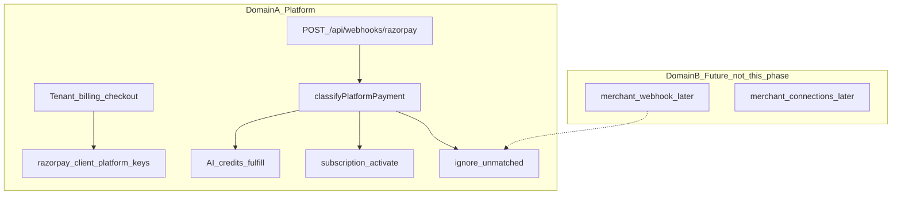

# PostBus Razorpay Phase 1 — Security Hardening Plan

**Status:** Implementation follows this document. Merchant payment tables, OAuth, and production deploys are out of scope.

Live hosted RLS/webhook behavior is **NOT VERIFIED** from static schema and code alone. Staging PostgREST checks must be recorded separately.

---

## 1. Verified findings

### SEC-03 — `platform_settings` readable by anon/authenticated — **CONFIRMED** (schema)

Evidence: [`supabase/migrations/20260924120000_billing_razorpay.sql`](supabase/migrations/20260924120000_billing_razorpay.sql) lines 544–558:

```sql
create policy platform_settings_admin_select on public.platform_settings
  for select using (true);
grant select on public.platform_settings to anon, authenticated;
```

No later migration revokes this. RLS is enabled; **no INSERT/UPDATE/DELETE policies** exist, so JWT roles cannot write (Postgres default-deny). **service_role bypasses RLS** and is the intended writer.

**Root cause:** Policy name says “admin_select” but `USING (true)` plus `GRANT SELECT` exposes **every column** via PostgREST to anyone with the published anon key. Encrypted ciphertext is still sensitive: `encrypted_razorpay_key_secret`, `encrypted_razorpay_webhook_secret`, plus later columns `encrypted_vachat_api_key`, `encrypted_vachat_webhook_secret`, `encrypted_openrouter_api_key`. Plaintext also exposed: `razorpay_key_id`, `razorpay_webhook_id`, `razorpay_mode`.

**App access (verified):** Tenant APIs do **not** read this table with the user JWT. Credential loads use `createAdminClient()` in [`modules/razorpay/config.ts`](modules/razorpay/config.ts), [`modules/openrouter/platform-config.ts`](modules/openrouter/platform-config.ts), [`modules/vachat/platform-config.ts`](modules/vachat/platform-config.ts), [`modules/ai-credits/catalog.ts`](modules/ai-credits/catalog.ts). Super Admin routes use service role in [`lib/api/admin/handle.ts`](lib/api/admin/handle.ts). SECURITY DEFINER org-create RPCs `select * into v_settings from platform_settings` internally and do not return secrets.

**Live exploit:** **NEEDS FURTHER INVESTIGATION** (requires staging PostgREST with anon key). Schema as shipped is sufficient to treat as HIGH.

### SEC-03b — Super Admin trial-settings returns `select("*")` — **CONFIRMED** (code)

[`lib/api/admin/handle.ts`](lib/api/admin/handle.ts) `GET trial-settings` and `PATCH trial-settings` `.select()` return the full row (ciphertext) to the Super Admin browser. UI only types `trial_enabled` / `trial_days`. Still a leak in the API envelope.

### SEC-02 — unmatched `payment.captured` grants AI credits — **NOT REPRODUCED** (current Domain A)

[`fulfill_ai_credit_purchase`](supabase/migrations/20261008180000_ai_credit_wallet.sql) matches `payments.razorpay_order_id` **and** `billing_cycle = 'ai_credits'`. Unknown orders return `{ handled: false }`. [`processRazorpayEvent`](modules/billing/webhooks.ts) then tries subscription match; if none, it does not activate.

**CONFIRMED residual risks:**

1. **Shared handler:** `payment.captured` always tries AI credits first, then subscriptions, in one function. Future merchant rows in `public.payments` would be unsafe.
2. **Unknown captured events are silent** (audit log only; no structured “unmatched” ignore).
3. **`refund.processed`** updates `payments` by `razorpay_payment_id` with no existence check before write.
4. **Single webhook** [`app/api/webhooks/razorpay/route.ts`](app/api/webhooks/razorpay/route.ts) uses only the **platform** HMAC secret. Signature verification of **raw body** is **CONFIRMED**.
5. Idempotency via `razorpay_webhook_events.event_id` unique + duplicate 200 is **CONFIRMED**. Headerless fallback hashes a 40-char body prefix (**MEDIUM**, keep for now).

### Domain mixing — **CONFIRMED** (architecture), merchant module **absent**

Shared today: [`modules/razorpay/client.ts`](modules/razorpay/client.ts) `getRazorpayCredentials()`, [`modules/razorpay/config.ts`](modules/razorpay/config.ts), `public.payments`, [`processRazorpayEvent`](modules/billing/webhooks.ts). WhatsApp/COD remain non-Razorpay.

---

## 2. Minimum required changes (Phase 1)

### A. Database

Migration `supabase/migrations/20261010080000_platform_settings_secrets_rls.sql`:

- `REVOKE ALL ON TABLE public.platform_settings FROM anon, authenticated, public;`
- `GRANT SELECT, INSERT, UPDATE, DELETE ON TABLE public.platform_settings TO service_role;`
- Drop `platform_settings_admin_select`.
- Do **not** add a JWT SELECT policy. Super Admin already uses service role.
- SECURITY DEFINER RPCs that read `trial_enabled` / `trial_days` continue to work.

Do not split secrets into another table this phase. Encryption-at-rest stays `encryptSecret` / `INTEGRATION_ENCRYPTION_KEY`.

### B. API leak

- `GET trial-settings`: `select("trial_enabled, trial_days")` only.
- `PATCH trial-settings`: same column list on `.select()`.

### C. Webhook domain router

Keep URL `POST /api/webhooks/razorpay`. Do **not** add a merchant webhook.

`payment.captured` routing:

1. `AI_CREDITS` if a `payments` row exists with `billing_cycle = 'ai_credits'` for the order id → fulfill only.
2. `SUBSCRIPTION` if a local subscription matches → existing activate / amount-mismatch ignore.
3. Else `UNMATCHED_PLATFORM` → log, mark event ignored, no payment insert, no credits, no subscription write.

`refund.processed` updates only when a matching `payments.razorpay_payment_id` exists.

Exported helper: `classifyPlatformRazorpayPayment`. Domain A freeze comments on Razorpay client/config. `public.payments` remains Domain A only.

### D. Docs

Update [`docs/billing.md`](docs/billing.md): platform webhook is Domain A; merchant webhooks must use a different URL later.

**Out of scope:** merchant connections, WhatsApp Razorpay checkout, OAuth, Route, new webhook URL in the Razorpay live dashboard, credential rotation.

---

## 3. Security implications

- Closing PostgREST SELECT stops ciphertext exfiltration of Razorpay/Vachat/OpenRouter secrets.
- Explicit unmatched-event ignore prevents a later merchant `payment.captured` on this URL from activating SaaS billing if it were signed with the platform secret.
- Super Admin trial API no longer ships ciphertext to the browser.

---

## 4. Regression risks

| Risk | Mitigation |
| --- | --- |
| Billing checkout cannot load keys | `getRazorpayConfig` already uses service role |
| AI credit catalog custom min/max fails | `catalog.ts` uses admin client |
| Org trial creation fails | SECURITY DEFINER RPC |
| Webhook ignores real subscription capture | Keep existing order_id / subscription_id match tests |
| Vachat/OpenRouter platform config | Admin client only |

---

## 5. Automated tests

- PGlite RLS: anon/authenticated cannot read `encrypted_*`; service_role can; authenticated cannot UPDATE/DELETE.
- Webhook: invalid HMAC rejected; unmatched `payment.captured` ignored; AI credit grant once; subscription capture still activates; amount mismatch ignores; unknown refund is a no-op.
- Do not change WhatsApp lifecycle or India Post COD modules.

---

## 6. Staging verification

1. With anon key: `GET /rest/v1/platform_settings?id=eq.1` → 401/empty, no encrypted columns.
2. Merchant dashboard subscribe checkout still opens; `GET /api/v1/billing` still returns public `keyId`.
3. Super Admin Razorpay settings: load/save/test/webhook register.
4. Trial settings page: only trial fields in network response.
5. Razorpay test-mode: subscription capture + AI credits capture + duplicate webhook.
6. WhatsApp order create + COD booking payload unchanged.
7. Do **not** send live refunds or live captures against production.

---

## 7. Rollback

- Revert the RLS migration only in emergency; prefer keep lock.
- Revert webhook router if captures stop matching; event table unchanged so Razorpay retries remain safe.

---

## 8. Acceptance criteria

- [ ] Anon/authenticated cannot read `platform_settings` secrets (pg test).
- [ ] Trial-settings API returns only trial columns.
- [ ] Unmatched `payment.captured` cannot grant credits or activate subscriptions (unit test).
- [ ] Matched AI credit and subscription captures still work.
- [ ] Invalid webhook signature rejected.
- [ ] Duplicate `event_id` still 200 without double apply.
- [ ] `modules/razorpay/*` documented as Domain A only; no merchant tables/routes.
- [ ] Targeted vitest files green.
- [ ] Staging PostgREST check recorded as VERIFIED or FAILED — do not claim production-fixed until staging.

---

## Architecture (Domain freeze)


