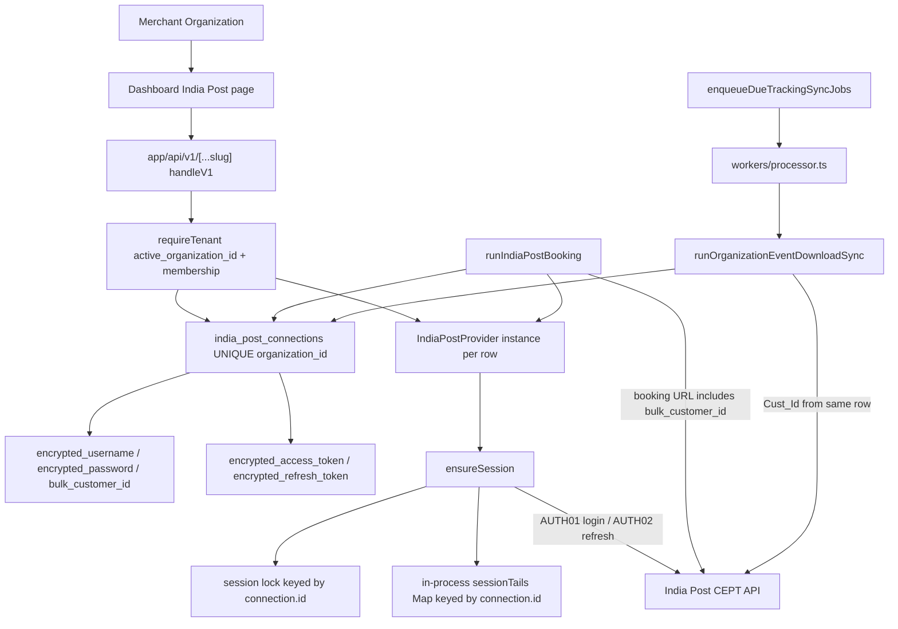

# India Post Tenant Authentication Audit

**Classification:** Read-only forensic architecture audit  
**Priority:** P0  
**Date:** 2026-10-22  
**Auditor role:** Principal software / security / multi-tenant architecture review  
**Scope:** PostBus repository + read-only inspection of the connected Supabase project  
**Code / data / env / deploy changes:** none  

**Evidence sources**

| Source | Status |
| --- | --- |
| Application source (`modules/india-post`, `lib/api/v1`, `workers/processor.ts`) | Inspected |
| Schema migrations under `supabase/migrations` | Inspected |
| Connected Supabase project `https://hgacoeoovjxkzfbesmvl.supabase.co` | Read-only SQL (constraints, RLS, counts, no secrets) |
| Isolated Vitest mocks | 6 files, 44 tests passed, 2026-10-22 |
| Production VPS process env / Coolify secrets | **NOT VERIFIED AT RUNTIME** (not dumped) |
| Live CEPT merchant API calls | **Not performed** (destructive / entitlement risk) |

Treat the connected Supabase project as the live application database. It is **not independently proven** in this audit to be production versus another hosted environment; row counts are consistent with a live merchant system.

---

## A. Executive Summary

PostBus authenticates to India Post **per merchant organization**, not through one shared platform customer account.

The storage model is hybrid only in this narrow sense:

- **Merchant credentials and tokens** live in `public.india_post_connections`, one row per `organization_id`.
- **CEPT host URLs** come from environment (`INDIA_POST_UAT_BASE_URL` / `INDIA_POST_PROD_BASE_URL`). Those are endpoints, not usernames, passwords, or access tokens.
- A **standalone diagnostic harness** (`scripts/india-post-tracking-test`) reads `INDIA_POST_USERNAME` / `INDIA_POST_PASSWORD` from its own env. That harness is not imported by booking, tariff, tracking, or workers.

No code path was found that silently substitutes another tenant’s India Post row, a global token singleton, or a Redis key `india-post:token` for merchant operations.

Two **data-plane** caveats remain:

1. Two distinct `bulk_customer_id` values are each stored on **two** organization rows (SHA-256 fingerprints `becfb4074f33` and `20abfec772f8`). That is merchant-entered identity reuse, not a shared PostBus token manager.
2. The connected database has **not** applied `20261021153000_tracking_lookback_and_event_download_lease`. Production Event Download lease RPCs are therefore missing on this project. That is concurrency/ops drift, not token sharing.

The recent TNT01/TNT02 HTTP 403 observed in the **standalone diagnostic** for customer `1392911671` is a **different code path** from production tracking, which calls `POST /event/download` and explicitly does not call `/tracking/bulk`. This audit does **not** attribute that 403 to cross-tenant token selection.

**Cross-tenant credential/token leakage: 0 confirmed vulnerabilities.**

---

## B. Current Architecture



Unknown at runtime (not inferred): Coolify value of `INDIA_POST_EVENT_DOWNLOAD_ORG_ALLOWLIST`.

---

## C. Actual Credential Storage Model

**Verdict: D — hybrid, with merchant secrets per organization and only host URLs in environment.**

### Table: `public.india_post_connections`

**Migration:** `supabase/migrations/20260919090200_integrations_platform.sql` lines 29–49  
**Live columns:** confirmed via `information_schema.columns` on 2026-10-22.

| Column | Role |
| --- | --- |
| `id` | UUID PK |
| `organization_id` | NOT NULL, UNIQUE, FK `organizations(id)` ON DELETE CASCADE |
| `environment` | UAT / PRODUCTION |
| `encrypted_username` | CEPT username (application encryption) |
| `encrypted_password` | CEPT password (application encryption) |
| `bulk_customer_id` | Contractual customer id used in booking URL and Event Download `Cust_Id` |
| `contract_id` | Legacy / fallback contract |
| `encrypted_access_token` | Cached access token |
| `encrypted_refresh_token` | Cached refresh token |
| `encrypted_id_token` | Optional id token |
| `expires_at` / `refresh_expires_at` / `last_refreshed_at` / `last_verified_at` | Expiry / verification clocks |
| `status` | Integration status |
| `session_lock_token` / `session_lock_expires_at` | AUTH lease |
| `booking_lock_*` | Booking lease (separate from session) |
| office / parcel default columns | Operational, not auth |

**Uniqueness (live):** `UNIQUE (organization_id)` — at most one India Post connection per tenant.  
**RLS:** enabled; `relforcerowsecurity = false`. Policies:

- `india_post_connections_select`: `is_org_member(organization_id)`
- `india_post_connections_write`: `has_org_role(..., OWNER|ADMIN)`

Service-role clients bypass RLS. Application queries audited below still filter `organization_id` (or `id` of a row already loaded under that org).

### Live row census (no secrets)

| Metric | Value |
| --- | --- |
| Connection rows / distinct orgs | 74 / 74 |
| `CONNECTED` | 37 |
| Username present | 40 |
| Access token present | 38 |
| Refresh token present | 37 |
| Distinct non-empty `bulk_customer_id` | 38 |
| Rows with diagnostic customer `1392911671` | 1 (`CONNECTED`, `PRODUCTION`, username + access + refresh present) |
| Customer IDs used by more than one org | 2 fingerprints, 2 orgs each |

### Environment credentials

`lib/env.ts` lines 42–57: UAT/prod **base URLs**, booking/tracking tunables, Event Download org allowlist. **No** `INDIA_POST_USERNAME` / `PASSWORD` / `CUSTOMER_ID` in application env.

Those names exist only under `scripts/india-post-tracking-test/`.

### Password storage method

`encryptSecret` / `decryptSecret` (`lib/security/crypto`). Ciphertext in Postgres. This audit did not decrypt values.

---

## D. Actual Login Flow

```
Dashboard PUT/POST integrations/india-post
  -> app/api/v1/[...slug] handleV1
  -> requireTenant (profile.active_organization_id + organization_members)
  -> handleIntegrationRoutes
  -> upsert india_post_connections { organization_id: ctx.organizationId, ...encrypted secrets }
  -> indiaPostFromRow(data).login()
  -> POST {CEPT}/v1/access/login { username, password }
  -> update same row WHERE organization_id = ctx.organizationId
```

| Step | Evidence |
| --- | --- |
| Org not taken from request body | `lib/api/v1/integrations.ts` 968–977: `organization_id: ctx.organizationId` |
| Tenant membership verified | `lib/api/context.ts` 39–58; test “rejects a user without membership” |
| Credentials loaded | Same upserted row; `IndiaPostProvider.login` decrypts that row (`provider.ts` 92–123) |
| Token stored | Connect path writes `encrypted_access_token` + `expires_at` on the **same** org (`integrations.ts` 1103–1115) |
| Refresh token on connect | **Not written** on this path (see finding IP-TAUTH-007) |
| Another org retrieving same token | Would require reading that row; merchant API uses `eq("organization_id", ctx.organizationId)` |

**Call graph (connect)**

- FILE: `lib/api/v1/handle.ts` FUNCTION: `handleV1` CALLS: `requireTenant` (line 73) then `handleIntegrationRoutes` (line 91)
- FILE: `lib/api/v1/integrations.ts` FUNCTION: `handleIntegrationRoutes` key `PUT/POST/PATCH integrations/india-post` CALLS: `indiaPostFromRow` → `provider.login` (1099–1101)
- FILE: `modules/india-post/provider.ts` FUNCTION: `login` CALLS: `fetch(sessionUrl("/access/login"))`

---

## E. Actual Access Token Flow

`IndiaPostProvider.ensureSession` (`provider.ts` 270–297):

1. If encrypted access token exists and `accessTokenStillValid(expires_at)` → decrypt and reuse.
2. Else if refresh token present and not expired → `refreshSession` (AUTH02).
3. On confirmed AUTH02 rejection / malformed envelope → AUTH01 `login` with **this instance’s** username/password.
4. Otherwise throw; **no other tenant’s row is loaded**.

Provider state is **instance fields** on `this.connection`. There is no module-level access-token variable.

Process-level queue `sessionTails` (`session.ts` 7, 43–62) is keyed by **`connectionId`**, not a global `"india-post"` key.

Database persist: `persistIndiaPostTokens` updates `india_post_connections` `.eq("id", connection.id)` and, when present, `.eq("organization_id", ...)` and fencing `.eq("session_lock_token", ...)`.

---

## F. Actual Refresh Token Flow

- Endpoint constant: `INDIA_POST_REFRESH_PATH = "/access/TokenWithRtoken"` (`session-tokens.ts` 5–6).
- Method: `IndiaPostProvider.refreshSession` (`provider.ts` 125–175): `Authorization: Bearer <this row’s refresh token>`, empty body.
- Persistence: `indiaPostSessionPersistPatch` encrypts rotated access (and refresh if returned) onto **the locked connection row**.
- Concurrency: `withIndiaPostSessionLock` RPC `acquire_india_post_session_lock(p_connection_id)` — **per connection UUID**, confirmed live on this database.
- Refresh failure: confirmed AUTH02 auth failure falls back to **this row’s** login, not another org.
- Silent fallback to another customer’s token: **not present** in `ensureSession`.

Connect/verify paths (`integrations.ts` 1103–1192) persist access token but **omit** `encrypted_refresh_token`. First refresh then depends on later `ensurePersistedIndiaPostSession` / booking / tariff persist, or a fresh login after access expiry.

---

## G. Token Cache Architecture

| Cache | Key | Isolation |
| --- | --- | --- |
| Postgres token columns | Connection row / `organization_id` UNIQUE | Per org |
| `IndiaPostProvider` instance | Object identity | Per constructed row |
| `sessionTails` | `connection.id` | Per connection |
| Event Download in-memory lock | `customerId:dates` (`event-download-lock.ts` 20–22) | Per customer id, **not** org id |
| Public live tracking Map | `${organizationId}:${barcode}` (`tracking-pages/public.ts` 68–69) | Per org + barcode |
| Redis / shared `india-post:token` | **Not found** | N/A |

Invalidation: access token cleared on 401 retry (`invalidateAccessToken`, `provider.ts` 193–196) on that instance; persist overwrites the same row.

---

## H. India Post API Call Matrix

| API operation | Entry point | Organization source | Credential / token source | Tenant isolation | Evidence |
| --- | --- | --- | --- | --- | --- |
| AUTH01 login | `IndiaPostProvider.login` | Caller’s connection row | That row’s encrypted username/password | Per instance | `provider.ts` 92–123 |
| AUTH02 refresh | `refreshSession` | Same | That row’s refresh token | Per instance | `provider.ts` 125–175 |
| PIN search | `searchPostOffices` / `validateShipment` | Connection used to construct provider | `ensureSession` on that provider | Per org lookup | `provider.ts` 227–245, 353–368 |
| Tariff | `tariffSession` / `getTariff` | `ctx.organizationId` | `loadTariffConnection(org)` | Reloads by org inside lock; rejects connection id mismatch | `tariff.ts` 28–32, 86–90 |
| Booking JSON | `bookShipment` | `runIndiaPostBooking(organizationId)` | Connection `eq organization_id`; URL uses `bulk_customer_id` | Shipments also `eq organization_id` | `booking-run.ts` 189–202; `provider.ts` 299–318 |
| Booking file | `bookShipmentFile` | Same | Same | Same | `provider.ts` 321–340 |
| Label PDF | `generateLabel` / `fetchOfficialIndiaPostLabelPdf` | Function `organizationId` | Connection `eq organization_id` | Shipment `eq organization_id` + `id` | `official-fetch.ts` 28–45 |
| Tracking Event Download | `downloadLatestEvents` | Provider connection | Token from that provider; `Cust_Id` from `bulk_customer_id` | Ingest matches org shipments only | `provider.ts` 465–601; `event-download-sync.ts` 330–350 |
| TNT01 GET `/tracking/` | **Not called** by production provider | — | — | N/A | `provider.ts` 465–468; `provider.session.test.ts` 530–531 |
| TNT02 POST `/tracking/bulk` | **Not called** by production provider | — | — | N/A | same |
| Cancel | Throws not supported | — | — | N/A | `provider.ts` 604–608 |
| Webhook ingest | `resolveProductionWebhookConnection` | Connection `id` or unique `bulk_customer_id` | No CEPT token (inbound) | Rejects ambiguous customer id; article org mismatch | `webhook.ts` 129–180, 113–126 |
| Public order-link PIN | `lookupPublicOrderLinkPincode` | Link’s `organization_id` | That org’s connection | No fallback to another org | `customer-order-links/public.ts` 159–166 |
| NDR/RTO refresh | `trackArticles` | `indiaPostConnection(org)` | `ensurePersistedIndiaPostTrackingSession` | Org-scoped | `ndr-rto/service.ts` 333–351 |
| Cron tracking enqueue | `enqueueDueTrackingSyncJobs` | `automation_settings.organization_id` loop | Connection `eq organizationId` | Skip if missing | `tracking-sync.ts` 147–170 |
| Worker tracking | `syncTracking` | `payload.organizationId` | Connection `eq payload.organizationId` | Throws if missing | `processor.ts` 729–768 |

---

## I. Booking Flow

`workers/processor.ts` `bookShipment` → `runIndiaPostBooking(supabase, { organizationId: payload.organizationId, shipmentIds })`.

- Shipments loaded with `.eq("organization_id", input.organizationId).in("id", input.shipmentIds)` (`booking-run.ts` 198–202). Injected foreign shipment UUIDs that belong to another org are not returned.
- Connection loaded with `.eq("organization_id", input.organizationId)` (189–193). Missing/not connected → error, no other-org fallback.
- Customer id on CEPT URL: `this.connection.bulk_customer_id` (`provider.ts` 301–306).
- Contract: `india_post_contracts` for **that** org, else `connection.contract_id` (`booking-run.ts` 258–382).
- Shopify / Woo / bulk / auto-booking all funnel into the same booking worker with an organization-scoped job payload (`processor.ts` 289–328).

Manual interactive booking uses the same `runIndiaPostBooking` after a background job is created with the tenant’s `organizationId`.

---

## J. Tracking Flow

Production `IndiaPostProvider.trackShipment` downloads Event Download for the connection’s customer id, then classifies requested barcodes (`provider.ts` 441–463). It does **not** call TNT01 or TNT02.

Org worker (`processor.ts` 729–799):

1. Requires `payload.organizationId`.
2. Loads **that** org’s connection.
3. `ensurePersistedIndiaPostSession(supabase, connection)` (requires `organization_id` on the connection).
4. `runOrganizationEventDownloadSync` with the same org id and `connection.bulk_customer_id`.
5. Ingests only articles whose barcode exists in **that** org’s `shipments` (`event-download-sync.ts` 330–350).

Feature flag: `isIndiaPostEventDownloadOpenForOrg` (`event-download-flags.ts`). In `NODE_ENV === "production"`, empty `INDIA_POST_EVENT_DOWNLOAD_ORG_ALLOWLIST` means **no orgs** receive Event Download. Runtime Coolify value: **NOT VERIFIED**.

Standalone diagnostic (`scripts/india-post-tracking-test`) **does** call TNT01/TNT02 with env credentials. That is not the production worker.

---

## K. Background Worker Flow

`processJob` always receives `payload.organizationId` (`processor.ts` 46–54). India Post jobs:

- `shipment-booking` → org booking
- `label-generation` → org label fetch
- `tracking-sync` → org Event Download
- Cron `enqueueDueTrackingSyncJobs` iterates automation orgs independently; one org’s missing credentials `continue`s to the next (`tracking-sync.ts` 156–168)

One failed tenant’s AUTH error does not load another tenant’s tokens. Auth-hold (`evaluateTrackingAuthHold`) is per `organizationId`.

---

## L. Super Admin Credential Usage

Searched `lib/api/admin` and `app/(admin)`: no global India Post username, password, access token, or default contractual customer id.

Admin surface `app/(admin)/admin/india-post-webhooks/page.tsx` is webhook health, not a shared CEPT login.

Platform env supplies CEPT **hosts** and Event Download allowlist only.

Local CEPT stub (`cept-local-stub.ts`) uses a shared `LOCAL_CEPT_TOKEN` for localhost stubs. **NOT APPLICABLE** to production CEPT hosts (`environment.ts` blocks live CEPT hosts on staging runtime).

---

## M. Cross-Tenant Security Tests

Executed as **mocked unit tests** (no production merchant credentials, no live CEPT). See `docs/audits/india-post-tenant-test-results.md`.

---

## N. Confirmed Vulnerabilities

**None** for cross-tenant India Post credential or token leakage.

---

## O. Potential Risks

See `docs/audits/india-post-security-findings.json` IDs IP-TAUTH-004 through IP-TAUTH-010.

Highest remaining **tenant-adjacent** issues:

- Duplicate merchant-entered `bulk_customer_id` (two pairs).
- Event Download in-memory lock keyed by customer id.
- Event Download lease migration not applied on the connected database.
- Global barcode uniqueness not enforced.
- Connect path omits refresh-token persist.

---

## P. Missing Evidence

- Coolify / VPS `INDIA_POST_EVENT_DOWNLOAD_ORG_ALLOWLIST` value.
- Whether the connected Supabase project is the Coolify production instance (URL observed; environment name not independently labeled).
- Live dual-org CEPT refresh under two real contracts (intentionally not executed).
- Whether duplicate customer-id pairs are the same legal merchant (two workspaces) or misconfiguration.

---

## Q. Recommended Fixes (not implemented)

1. Unique constraint or admin warning on `bulk_customer_id` + `environment` when two production orgs would share a customer id.
2. Apply `20261021153000_tracking_lookback_and_event_download_lease` to the live database after change-control (out of scope here).
3. Persist refresh token on connect/verify using `indiaPostSessionPersistPatch`.
4. Make `persistIndiaPostTokens` require `organization_id` (already required by `ensurePersistedIndiaPostSession`).
5. Optional unique index on `shipments (organization_id, barcode)` and monitoring for cross-org barcode collisions.
6. Keep Event Download allowlist explicit; do not treat TNT 403 diagnostics as production tracking failures.

---

## R. Final Security Verdict

**PostBus uses isolated India Post credentials and tokens per `organization_id` for merchant operations.** It does not implement a shared platform customer account or a global access token for booking/tracking.

**Overall risk for the asked P0 (cross-tenant token mix): LOW.**  
**Residual operational risk (Event Download lease drift, duplicate customer ids, allowlist): MEDIUM.**

The TNT HTTP 403 from the standalone diagnostic is **not explained** by this tenant-auth architecture. Production tracking never selects TNT01/TNT02. A 403 on Event Download, if observed in the app, would still be evaluated as **that org’s** customer entitlement, not as “Merchant A used Merchant B’s token,” unless a new unsafe path is introduced.

---

## Final questions

| ID | Answer | Confidence |
| --- | --- | --- |
| Q1 | **No as a universal fact; yes as the architecture.** Each org has its own connection row. Not every org has credentials. Two customer IDs are reused by two orgs each. There is no platform-owned shared merchant account. | High (schema + census) |
| Q2 | **Yes, when that org authenticates.** Tokens are generated from that row’s username/password or refresh token. | High |
| Q3 | **Token records are not shared.** Two orgs can hold separate tokens for the **same** India Post customer if they entered the same id. | High |
| Q4 | **Yes** — columns on the org’s unique connection row. | High |
| Q5 | **Yes** — refresh uses that row; lock is `connection.id`. | High |
| Q6 | **Yes** — booking loads connection and shipments by the job’s `organizationId`. | High (code); live CEPT not replayed |
| Q7 | **Yes for Event Download.** Production does not use TNT. Token/Cust_Id come from the same org row. | High |
| Q8 | **Yes** — `payload.organizationId` on every inspected India Post job. | High |
| Q9 | **No merchant username/password/token in app env.** Host URLs and allowlist only. Diagnostic script env is separate. | High for repo; Coolify secrets not dumped |
| Q10 | **Merchant UI/API: no**, given membership + RLS + `ctx.organizationId`. Service-role workers can read any row but do so with an explicit org filter. | High for HTTP; service-role is trusted compute |
| Q11 | **Not via token selection.** Possible only if Merchant B’s shipment is processed with an org id that points at A’s connection (not found) or if both orgs configured the same customer id (same India Post identity, different PostBus rows). | High |
| Q12 | **No evidence that production tenant token selection caused the diagnostic TNT 403.** Diagnostic used env login for `1392911671` (one DB row). Production tracking uses Event Download. | High for “not TNT mixup”; Event Download 403 entitlement remains a separate India Post question |

---

## Scorecard

| Control | Result | Evidence |
| --- | --- | --- |
| Credential isolation | **PASS** (design); duplicate customer IDs are config | UNIQUE `organization_id`; queries `.eq("organization_id")` |
| Access token isolation | **PASS** | Per-row encrypted token; provider instance; test “does not share in-memory tokens” |
| Refresh token isolation | **PASS** | AUTH02 uses that row; session lock per `connection.id` |
| Token cache isolation | **PASS** with Event Download lock caveat | Postgres + connectionId maps; ED lock uses customer id |
| Booking tenant isolation | **PASS** | `booking-run.ts` 189–202, 301–306 |
| Tracking tenant isolation | **PASS** for org/token selection | `processor.ts` 739–768; ingest org barcode map |
| Background worker isolation | **PASS** | Job payload org id |
| Global credential fallback | **ABSENT** for merchant ops | No env merchant secrets; missing connection throws |
| Cross-tenant vulnerabilities | **0 confirmed** | See findings JSON |
| Overall P0 token-mix risk | **LOW** | — |
| Residual ops risk | **MEDIUM** | Lease migration missing; duplicate customer ids |
