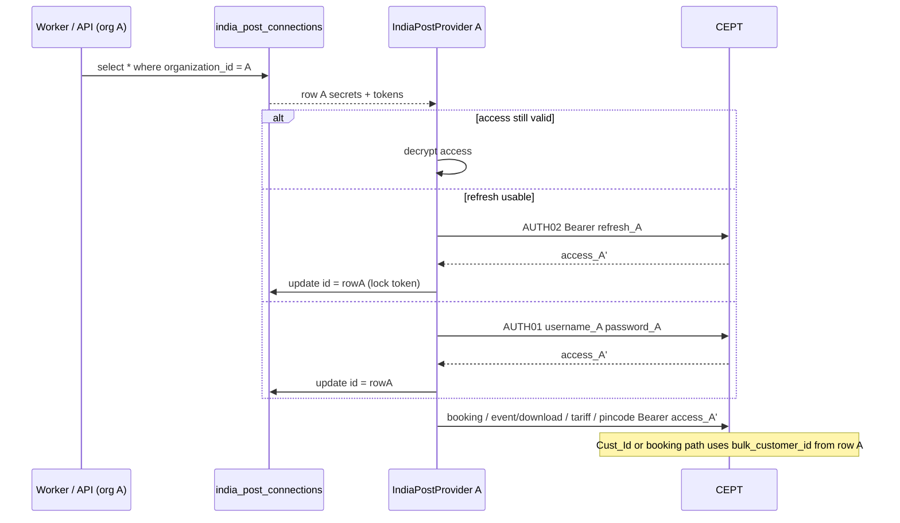

# India Post Token Flow (As Implemented)

**Date:** 2026-10-22  
**Companion:** `docs/audits/india-post-tenant-auth-audit.md`  
**No production changes.**

---

## 1. Identity objects

| Object | Identity | Stored where |
| --- | --- | --- |
| Tenant | `organizations.id` | Postgres |
| India Post integration | `india_post_connections.id` | Postgres, UNIQUE(`organization_id`) |
| CEPT login | decrypted `encrypted_username` / `encrypted_password` | Ciphertext on the integration row |
| Contractual customer | `bulk_customer_id` | Plain text on the integration row |
| Access token | decrypted `encrypted_access_token` | Ciphertext on the same row |
| Refresh token | decrypted `encrypted_refresh_token` | Ciphertext on the same row |

There is no platform-level India Post user table and no Redis token store in this codebase.

---

## 2. Login (AUTH01)

```
Merchant Owner/Admin
  -> PUT/POST /api/v1/integrations/india-post  (connect !== false)
  -> handleV1
  -> requireTenant  // NOT body.organization_id
  -> upsert india_post_connections on conflict organization_id
  -> IndiaPostProvider.login
  -> POST {indiaPostSessionUrl(env)}/access/login
       JSON { username, password }
  -> parseIndiaPostSessionTokens(json.data)
  -> UPDATE india_post_connections
       SET status=CONNECTED,
           encrypted_access_token=encrypt(access),
           expires_at=now+expires_in,
           last_verified_at, last_refreshed_at
       WHERE organization_id = ctx.organizationId
```

**Files**

- `lib/api/v1/handle.ts` 73, 91
- `lib/api/context.ts` 18–74
- `lib/api/v1/integrations.ts` 968–1136
- `modules/india-post/provider.ts` 92–123
- `modules/india-post/session-tokens.ts` 26–37

**Gap:** connect/verify updates do not persist `encrypted_refresh_token` even when AUTH01 returns one (`integrations.ts` 1103–1115, 1182–1192).

---

## 3. Session ensure (reuse / refresh / login)

```
ensureSession(this.connection):
  if access present AND expires_at - now > 60s:
       return decrypt(access)   // tokens: null (no DB write)
  if refresh present AND refresh_expires_at still valid (missing expiry allowed):
       try AUTH02
       on confirmed AUTH02 failure or malformed body: fall through
       on timeout / 5xx: throw (no AUTH01)
  AUTH01 login with this.connection credentials
```

**File:** `modules/india-post/provider.ts` 270–297, helpers 177–205.

`rememberSession` writes tokens only onto **this provider instance**. Durability requires `persistIndiaPostTokens`.

---

## 4. Refresh (AUTH02)

```
POST {sessionUrl}/access/TokenWithRtoken
Authorization: Bearer <refresh>
(no JSON body)
```

**File:** `modules/india-post/session-tokens.ts` 4–6; `provider.ts` 125–175.

Rotation: if AUTH02 omits `refresh_token`, `rememberSession` keeps the previous encrypted refresh (`provider.ts` 180–182). Confirmed by unit test “keeps the previous refresh token when AUTH02 omits rotation”.

---

## 5. Persistence and fencing

Workers and public tracking that must survive process recycle:

```
ensurePersistedIndiaPostSession(supabase, connection)
  require organization_id
  withProcessSessionLock(connection.id)
    withIndiaPostSessionLock(connection.id)  // RPC acquire_india_post_session_lock
      reload row by id + organization_id
      provider.ensureSession()
      persistIndiaPostTokens(..., sessionLockToken)
```

**Files:** `modules/india-post/session.ts` 11–157; `session-lock.ts` 110–160.

SQL (live): `acquire_india_post_session_lock(p_connection_id uuid)` updates **only** `where id = p_connection_id` and expired-or-null lease. Cannot overwrite another connection’s tokens.

Booking and official labels call `provider.ensureSession()` then `persistIndiaPostTokens` without the session helper in some paths (`booking-run.ts` 366–368, `official-fetch.ts` 83–85). Those still target `connection.id` from the org-scoped select. Concurrent AUTH for the **same** org can race unless those paths also take the session lock (tariff already does). That is **same-tenant** refresh racing, not cross-tenant overwrite.

---

## 6. Token selection for outbound CEPT calls

Every outbound CEPT call on `IndiaPostProvider` uses `this.token()` → `ensureSession()` → `Authorization: Bearer <access>`.

Customer id is **not** taken from the HTTP caller:

- Booking: `indiaPostBookingUrl(env, this.connection.bulk_customer_id)`
- Event Download: `Cust_Id: indiaPostEventCustomerId(this.connection.bulk_customer_id)`

If `bulk_customer_id` is missing/invalid, booking and Event Download fail closed (`provider.ts` 301–304, 470–476). They do not substitute another org’s customer id.

---

## 7. Diagram (actual)



There is no sequence step “if org A missing, load org B”.

---

## 8. What production tracking does **not** do

`trackShipment` → `downloadLatestEvents` → `POST /event/download`.

Comments and tests forbid `/tracking/bulk` (TNT02). The standalone diagnostic in `scripts/india-post-tracking-test` **does** call TNT01/TNT02 using env credentials. Do not treat that harness as the production token manager.
